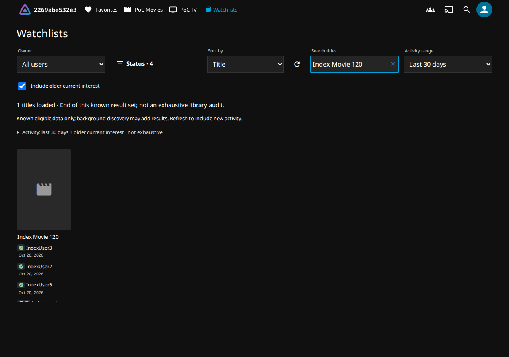
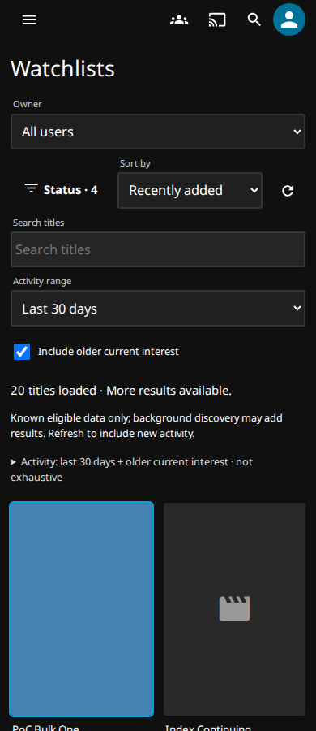
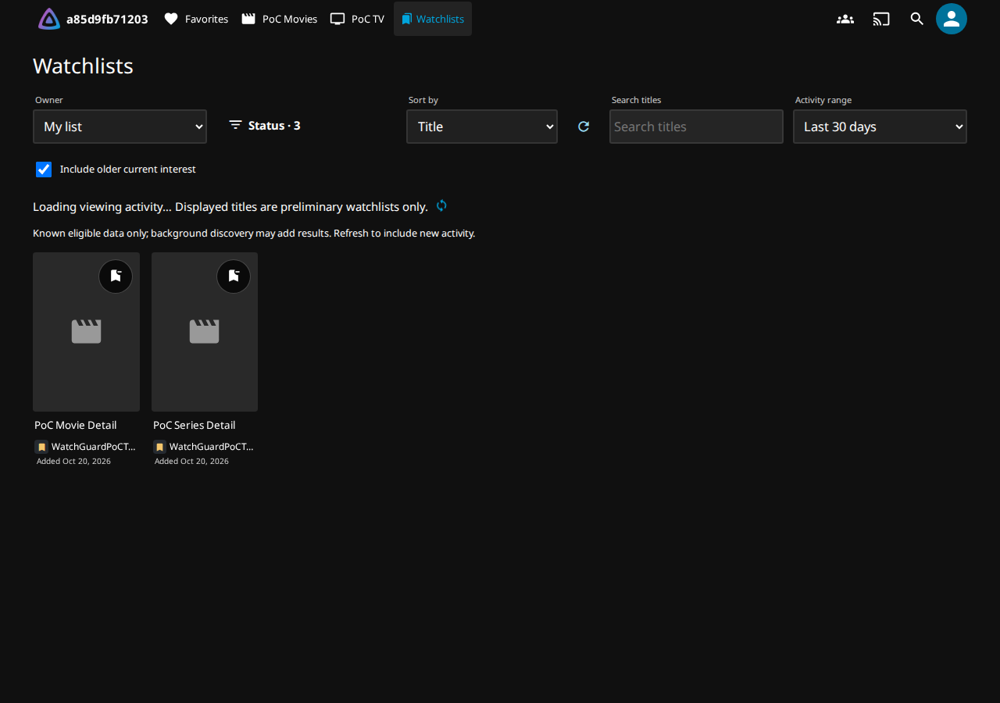

# Activity browser v0.7.0 qualification

Unpublished candidate; no merge, release, catalog update or deployment.

## Reproducible candidate

The implementation and fixture commit qualified by this run is
`2845703162cbdf42379365bb2415da509d38c66a`.
[Full qualification](https://github.com/MajorSchloch/jellyfin-plugin-watchguard/actions/runs/39449366419)
passed its build and all eleven integration suites with `publish=false` and
`proxy_matrix=true`; publication was skipped. The later evidence commit changes
only documentation and screenshots. [Machine-readable provenance](evidence/activity-browser-v070/qualification.json)
records the jobs, artifacts and checksums.

Candidate ZIP SHA-256:
`3203a61e3c63e0f84e3cdbed472c8508e5dac043af6a10bd7a059ea16bcc61db`.
The local build and downloaded CI package have identical checksums. CI also
rebuilds the package and compares checksums. The archive contains only the plugin
DLL and LICENSE; the Web adapter is embedded. Public `manifest.json` is unchanged.

Qualification uses Jellyfin Server/Web 12.2.0, .NET SDK 10.0.302, Node 24.22.0,
Python 3.12.0 and Playwright 1.56.1 on disposable Ubuntu 24.04 GitHub runners.
Official and LinuxServer Jellyfin images remain digest-pinned by the workflow.

## Regression coverage

The qualification build passes 282 backend tests, 141 JavaScript tests, 15 Python infrastructure
checks and four catalog tests. The existing deletion, approval and security
assertions remain enabled.

| Failure mode | Evidence |
| --- | --- |
| Match beyond the former first page | Backend: 71 titles, unique Watching/search match; selective 720-owner-row fixture returns its match immediately without playback classification |
| Global ordering and unknown dates | Three sort modes over multiple pages; selected status/owner contributions; unknown legacy membership dates; independent native comparison |
| Explicit, automatic and live union | Stable title/user deduplication, independent explicit date window, native viewing dates, Watching/Caught Up, 3/3 +N details |
| Authorization changes | Current requester/owner item access, episode-set revocation, policy invalidation, disabled native owner, private work diagnostics and candidate bounds |
| Continuations | Complete query/caller binding, expiry, partial-title owner continuation under episode limits, no duplicate owners, bounded progress and stable ordering across unchanged reverification |
| Browser races | Debounced search, superseded responses, checkbox/filter changes while paging, account switch, 401/403 clearing, both poll/pagination and refresh/pagination orders |
| Retained view | Inline expired-view Refresh retains controls/cards; unchanged poster and focused removal button survive pagination; ordinary update failures retain loaded data |

## Native v0.6.0 comparison

The benchmark downloads the published v0.6.0 package and verifies SHA-256
`3542b971231b51a78d9783b490f1438b231cd0fca48b61c6aad5098528d50bd7`
before loading its DLL. It then loads the exact candidate DLL in the same
disposable fixture, waiting for background verification after each restart.

The fixture adds 120 movies, one 300-episode continuing series, six viewing
accounts plus the administrator, six explicit memberships and one live playback
owner. Existing fixture titles provide an explicit-only movie. Each scenario has
one warm-up and three measured samples, with sequential requests. The native
comparison checks title IDs, selected owner IDs, reasons and global ordering,
and asserts that page queries cause zero background playback-classification
batches. A native owner-policy revocation must invalidate a saved continuation
before another page is disclosed.

v0.6.0 has no combined filtered/sorted query. Its raw index first-page latency is
recorded separately; a globally comparable answer requires its membership request
and complete index pagination followed by benchmark-side filtering/sorting.
That benchmark operation is not implemented in the browser. Candidate
first-ordered-page latency includes any bounded preparation requests.
Timings cover native HTTP queries, not browser paint. The candidate browser also
fetches a separately labelled membership preview; that optional preliminary
request is not needed by its combined-query API and is outside these timings.

Median milliseconds from three measured samples (one warm-up):

| Query | Titles | v0.6 raw first index page | v0.6 globally ordered answer / complete | v0.7 first ordered page | v0.7 complete |
| --- | ---: | ---: | ---: | ---: | ---: |
| All owners · Title | 122 | 47.8 | 237.1 | 103.6 | 261.4 |
| One owner · Playback recency | 121 | 30.4 | 131.9 | 22.2 | 113.5 |
| Watchlisted · Recently added | 3 | 49.2 | 242.1 | 28.5 | 28.6 |
| Watched · title search | 1 | 48.1 | 229.0 | 35.0 | 35.1 |
| Watching · Playback recency | 1 | 47.5 | 226.3 | 46.6 | 46.6 |
| Currently playing · Title | 1 | 47.3 | 226.2 | 17.9 | 17.9 |

The broad v0.7 query first returned bounded preparation in 49.6 ms, then its
first ordered page at 103.6 ms. Complete pagination took 261.4 ms versus 237.1 ms
for the baseline combined answer: the additional authorization work costs about
10% here. The selective search reached its single title in 35.0 ms with one
request; v0.6 needed all six requests to establish the same global answer.

Work across complete pagination (stable across the three samples):

| Query | Requests v0.6 → v0.7 | Episode queries v0.6 → v0.7 | Episode rows v0.6 → v0.7 | v0.7 authorized pair resolutions |
| --- | ---: | ---: | ---: | ---: |
| All owners · Title | 6 → 6 | 7 → 14 | 2100 → 4200 | 1454 |
| One owner · Playback recency | 6 → 5 | 2 → 2 | 600 → 600 | 363 |
| Watchlisted · Recently added | 6 → 1 | 7 → 3 | 2100 → 900 | 15 |
| Watched · title search | 6 → 1 | 7 → 0 | 2100 → 0 | 12 |
| Watching · Playback recency | 6 → 1 | 7 → 7 | 2100 → 2100 | 13 |
| Currently playing · Title | 6 → 1 | 7 → 0 | 2100 → 0 | 2 |

v0.6 does not expose a pair-resolution counter; zero in that raw JSON field
means unavailable, not zero native work. Both versions caused **zero playback
classification batches** during every measured scenario. Broad v0.7 pagination
repeats episode authorization during preparation and disclosure, explaining the
higher episode-row count. Selective movie searches avoid episode queries.
Initial verification after package restart took 268.4 s for v0.6 and 268.3 s for
v0.7; warm timings exclude that background population.

[Raw samples and fixture](evidence/activity-browser-v070/native-comparison.json),
[native browser checks](evidence/activity-browser-v070/native-browser.json),
[proxy matrix](evidence/activity-browser-v070/proxy-compatibility.json) and
[native proxy-policy boundary](evidence/activity-browser-v070/native-remote-access-proxy.json)
are retained with this report. Native search, clearing search, page progress,
poster-node identity, search focus and the 390px no-overflow assertion passed;
this final run needed no expired-view recovery.

## Screenshots

All captures come from the same qualification run's disposable libraries.
The activity-index suite provides the search and mobile captures; the basepath
suite deliberately holds the activity response for the preliminary state.

Desktop title search reaches its matching title without loading unrelated cards, while retaining focus:

Recently added at 390px preserves the poster layout and reports loaded results and more pages:

Explicit memberships remain available during loading, labelled as preliminary:

## Limits

These are warm, single-client fixture measurements, not a load test or a claim
about the user's production library. Read diagnostics count authorized work;
restricted views can perform additional suppressed authorization work.
Uninstrumented native title lookups and file-store reads are not reported as
playback classification.

Each snapshot considers at most 10,000 candidate title/owner pairs. Native item
lookups and episode visibility have separate request budgets; preparation may
need explicit continuation. Fixed candidate/live ceilings are disclosed without
revealing hidden candidate cardinality. Coverage remains partial even at the end
of pagination. Snapshots last five minutes, with two per caller and sixteen
globally; eviction or relevant metadata/activity/permission changes can require
Refresh. Newly discovered results require Refresh, and polling never reorders a
deeply paged view.

Earlier qualification attempts exposed fixture synchronization failures: a stale
Docker port after restart, a late native login chooser, and an asynchronous
Playwright predicate that returned before the seeded index was verified. The
fixture now explicitly awaits verification and records bounded expiry recovery;
it never retries sign-in, approval or deletion. A separate backend regression
reproduced snapshot expiry after unchanged background reverification. Structural
comparison now preserves that view while actual displayed metadata changes still
expire it. Failed and superseded runs are not counted as successful qualification.
