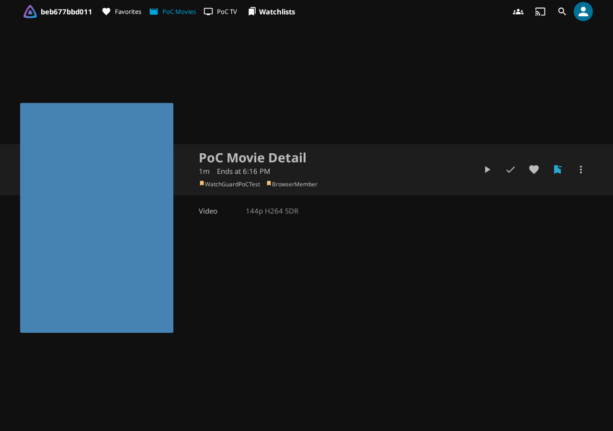
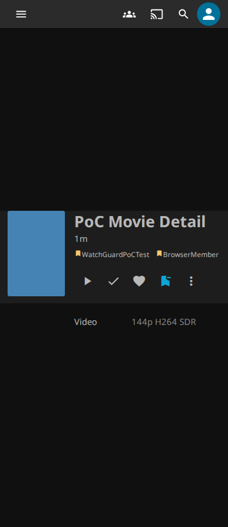

# WatchGuard v0.7.8 compatibility and action verification

Unpublished v0.7.8 qualification completed on `292f65b742ba5fac25c71aefa20f489ec85ba924`. Published v0.7.7 remains unchanged.

## Official changes reviewed

The [Server v12.3…v12.4 comparison](https://github.com/jellyfin/jellyfin/compare/v12.3...v12.4) changes .NET packages/tooling to 10.0.14 and release version metadata. Native deletion controller, binding, authentication, library/user-data/session interfaces and loader routes have no source changes in this delta.

The [Web comparison](https://github.com/jellyfin/jellyfin-web/compare/v12.3...v12.4) changes package version metadata and `@jellyfin/sdk` 1.0.1 → 1.0.2; no native layout/routing source files change. The [SDK comparison](https://github.com/jellyfin/jellyfin-sdk-typescript/compare/v1.0.1...v1.0.2) prevents WebSocket URL updates without a session, clears the retained socket URL on disconnect and clears the session token even if logout fails. Generated API version metadata moves to 12.3.0. These changes specifically justify retaining websocket/logout/account-isolation regressions rather than assuming unchanged behavior from unchanged DOM files.

Both actual released image assemblies passed preliminary structural inspection before extending the range: `DeleteItem(Guid itemId)` and `DeleteItems(Guid[] ids)`, ActionResult, native DELETE routes, default authorization and native comma-delimited query binding. This inspection did not claim active enforcement: the previous version envelope still rejected 12.4. Runtime configurations in both images specify .NET/ASP.NET 10.0.14. Integration tests must additionally establish final attachment, native behavior and actual Server/Web versions.

Minimum catalog ABI remains 12.2.0.0; Controller/Model dependencies remain 12.2.0 and the target remains .NET 10. The same package is required on all three hosts. The bounded release envelope is 12.2.x, 12.3.x and 12.4.x; later minors, majors, prereleases and nonzero revision builds remain unsupported. Patch simulations are not real-release qualification. No structural, authorization or actual-enforcement checks are relaxed.

## Images

- Official: `jellyfin/jellyfin:12.4@sha256:fea863d0cd9ec445985d9c75fc6ed64e38a1d2766cf0c250a33d553f4fc1b771`
- LinuxServer: `lscr.io/linuxserver/jellyfin:12.4ubu2604-ls57@sha256:3894d9eae88418d3cf9ac6349392d2c4dad818365a59565d19edc38098897044`

Existing 12.2/12.3 immutable fixtures remain unchanged in `tests/fixture_images.py`. Local preflight uses arm64; hosted qualification uses amd64.

## Watchlist action

The actionable detail button changes from a plain bookmark to `bookmark_remove` when saved. Plain membership status indicators, turquoise active styling, accessible labels and tooltips remain unchanged. Native desktop/mobile tests exercise add/remove, both failed writes, repeated activation while a request is pending, node identity, keyboard focus after success/failure, visible minus without hover, unchanged media/user data and another account’s retained membership. Existing navigation/account switching regressions remain required.

The native preflight exposed an existing self-invalidation: the shared membership callback remounted the detail button before its own write completion. Detail-origin writes now finish in place; menu/card writes still invalidate details. The existing request, error and identity checks remain, with a disabled-action guard and focus restoration only if the same view/account is current and the user has not focused another control. No additional request, timer or listener is introduced.

## Final qualification

[Unified qualification](https://github.com/MajorSchloch/jellyfin-plugin-watchguard/actions/runs/40557055801) passed on exact commit `292f65b742ba5fac25c71aefa20f489ec85ba924` with `publish=false` and `proxy_matrix=true`: build, all **33 integration suites** (11 per supported version), and the evidence gate passed; publication was skipped. One identical package was used throughout. Hosted and local packages are byte-identical.

- ZIP SHA-256: `fd4a0aba1232c4d5b57b80c336e50ed27cdd12502b31e5fd2ccc44e67aede7c3`
- DLL SHA-256: `a19bd559f8515db062f4debce1447a88f296e4ca1b69b5b3e44cb4c2ee959e5c`
- 376 backend, 194 JavaScript, 26 infrastructure and eight catalog tests passed.
- Runtime last changed in `3a4ca3d4759137c84ed364262d95c37f8e6ad115`; the tested commit additionally corrects the native catalog version assertion.

| Actual Server / Web | Official and LinuxServer | Suites | Native action layouts |
| --- | --- | --- | --- |
| 12.2.0 / 12.2.0 | Both pinned images verified | 11/11 | 1280 px and 390 px |
| 12.3.0 / 12.3.0 | Both pinned images verified | 11/11 | 1280 px and 390 px |
| 12.4.0 / 12.4.0 | Both pinned images verified | 11/11 | 1280 px and 390 px |

Both packaged 12.4 runtimes report .NET/ASP.NET 10.0.14. The [machine-readable summary](evidence/compatibility-v078/summary.json) records all six image identities, native contracts, capability results, Server/Web versions, action cases, drawer/navigation/startup observations and catalog checks. The [qualification gate](evidence/compatibility-v078/qualification.json) records every command, elapsed time, package/runtime checksum and commit.

All required existing activity filtering/pagination/polling/playback/watched-state, approval, permission, account-isolation, startup, drawer, navigation, native catalog and proxy/base-path regressions passed. Native catalog coverage includes available and installed pages at both widths and all 26 revision entries. No assertion or resource limit was weakened.

### Screenshots

Jellyfin 12.2.0:

Jellyfin 12.3.0:

Jellyfin 12.4.0:

### Limits and superseded evidence

Browser checks use the pinned Chromium fixture, desktop and responsive mobile layouts, and synthetic movies/series/accounts. They do not certify every physical mobile browser, custom Web build/theme, third-party middleware or external deletion tool. Exact tested releases are 12.2.0, 12.3.0 and 12.4.0; simulated later patches are only capability-policy tests. Protection remains limited to verified native HTTP deletion hooks, with the documented failure behavior unchanged.

Early local preflight failures are [recorded separately](evidence/compatibility-v078/preflight-failure.json): Docker's cache filesystem failed Jellyfin's free-space requirement, the existing detail-write callback replaced the button, and the enforcement fixture still expected two tested versions. The cache now uses temporary host storage; native free-space checks remain intact.

Run 40554887580 was cancelled to narrow notification suppression to the originating detail write. Run 40555482215 encountered a stale escaped 0.7.7 installed-image URL expectation while Jellyfin correctly served 0.7.8, then its remaining jobs were cancelled. The [failure text](evidence/compatibility-v078/superseded-catalog-failure.txt) and [native failure screenshot](evidence/compatibility-v078/superseded-catalog-failure-1280.png) are preserved. The test now derives the version from build metadata. No failed or cancelled result is counted in final qualification, and no failed suite was silently retried.

The public catalog, historical installation metadata and published binaries remain unchanged. Nothing was merged, published or deployed.
