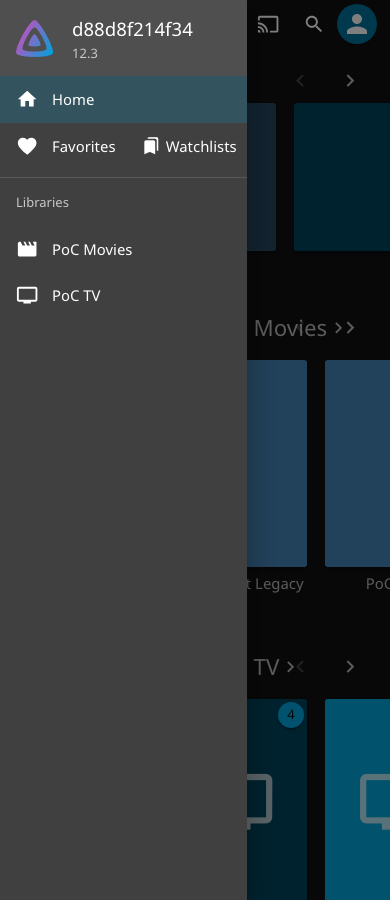
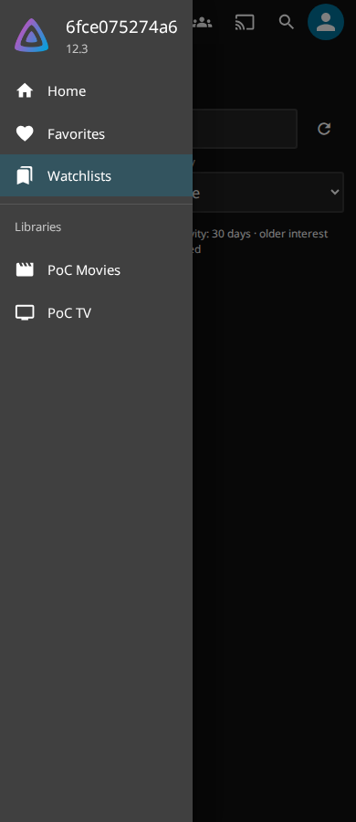
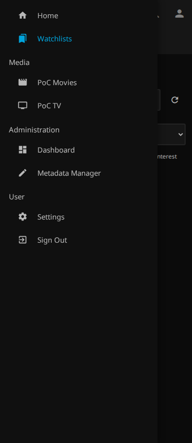

# Mobile drawer and unified qualification — v0.7.5

This follow-up started from master `0d07009`. Published v0.7.4 was added to master during the work, so the PR now includes catalog commit `fe24bc1` and prepares v0.7.5. The published v0.7.4 package and catalog entry are unchanged. Historical [startup evidence](startup-validation-v074.md) remains unchanged; the follow-up is qualified separately because its embedded runtime differs.

## Reproduction and implementation

On native Jellyfin Web 12.3.0 at 390px and 600px, the old adapter appended Watchlists to Favourites' `<li>`. Both links occupied one row; the Watchlists link began at x=131.5 rather than the row’s x=0. The legacy drawer had no Watchlists entry. Baseline measurements are retained in `evidence/drawer-v075/pre-version/baseline.json`.

The adapter now distinguishes the modern drawer list, legacy drawer scroll container and desktop/header navigation. It owns a sibling `<li>` in the modern drawer, and an anchor after Home in the legacy drawer. It removes only its own row/link when the layout, container or account changes. There is one owned navigation link at a time; existing reconciliation handles reopening/resizing without new timers or network requests.

Legacy styling uses the native `navMenuOption` icon/text contract. Modern styling reads a short whitelist of computed presentation properties from MUI's semantic slots: row padding/font, icon size/column width, text margin/font and selected color. It does not copy generated `css-*` classes or guess screen offsets. Native delegated click handling closes both drawers, including same-route activation. Modern Enter keydown is kept local so it produces exactly one native delegated click; otherwise the ancestor's early keydown dismissal can restore focus to the opener before activation finishes. Normal links/history, modifiers, authorization and the activity query are unchanged.

The native Web's configured custom-menu links are external-link integration, not a runtime registration point for this authenticated in-place view. This patch therefore uses explicit, tested layout adapters and native dismissal. Those DOM contracts still require qualification when Jellyfin Web changes.

## One qualification and publication gate

A single `release.yaml` dispatch builds the deterministic package once, then runs the eleven existing suites on **both** pinned versions. Every integration job downloads and checksum-verifies that same package. Evidence names include the host version to prevent collisions.

The final qualification job requires exactly 22 successful, non-retried suite reports, the requested commit, and matching package and DLL hashes. Missing hosts/suites, failures, duplicates and mixed artifacts fail the gate. Requested proxy coverage must be present for both hosts; publication always enables the full proxy matrix even if its optional dry-run input was false. Publication depends on build, the entire integration matrix and the evidence gate, still requires explicit `publish=true`, the default branch and release environment approval, and downloads the original build artifact without rebuilding it.

## Validation

The native drawer test observes the **open** drawer at 390px and 600px in both layouts, repeated opening, touch navigation, Enter activation on the current view, active state, alignment/row height/full width, overflow, breakpoint changes and desktop navigation. It asserts exactly one link and no generated classes. Existing filter transition and initial-document startup/reload observers remain in the base-path suite.

The pre-version local fixture passed all six open-drawer cases, two desktop layouts and breakpoint transitions. All 36 native filter transitions and six history/navigation travel cases pass, with no Home exposure, panel replacement, unexpected overlay or focus loss. The startup suite passes 24 initial-document scenarios with zero Home-visible frames, four Refresh scenarios and 14 recovery scenarios. Fast checks on v0.7.5 pass: 321 backend tests, 191 JavaScript tests, 26 infrastructure tests and four catalog tests.

The first consolidated run [40081087661](https://github.com/MajorSchloch/jellyfin-plugin-watchguard/actions/runs/40081087661) passed all 22 integration suites and the evidence gate on `ef982ccfb2211ebcca597edd094fa3756660bf2f`, using pre-version candidate ZIP `6d1a6ac52b3dbc2c8e677ca2c52f9a9140c40166b2a95787923eed3c68b035a1`. Its [complete evidence](evidence/drawer-v075/pre-version/qualification.json) is retained separately. It is **not** qualification of the final v0.7.5 package.

[Final v0.7.5 qualification run 40083551172](https://github.com/MajorSchloch/jellyfin-plugin-watchguard/actions/runs/40083551172) **passed** with `publish=false`, `proxy_matrix=true` on runtime commit **`289af755cd0b7af42636333a5f95871488e724c5`**. The build, all 22 integration jobs and the final evidence gate passed; publication was skipped. Subsequent changes contain documentation/evidence only.

| Native Server / Web | Integration suites | Open-drawer cases | Filter transitions | Startup / Refresh / recovery |
| --- | --- | --- | --- | --- |
| 12.2.0 / 12.2.0 | 11 PASS | 6 PASS | 36 PASS | 24 / 4 / 14 PASS |
| 12.3.0 / 12.3.0 | 11 PASS | 6 PASS | 36 PASS | 24 / 4 / 14 PASS |

Both hosts recorded zero Home-visible startup frames, zero filter-transition Home exposure, unexpected overlays, panel replacements or focus losses. Official and LinuxServer enforcement fixtures and both full proxy/security matrices passed. Activity population, filtering/pagination, watched-state and playback polling, deeper-view recovery and account-isolation assertions also passed.

The single final package is `Jellyfin.Plugin.WatchGuard-v0.7.5.zip`:

- ZIP SHA-256: `03ac773e2b82fec870f4bd0a7200cd128e0bc2360bf3492461a2662490813dbc`
- DLL SHA-256: `a9b22eef117d6c590773df35262861b34c03703dfa474767e163729deeff6bd8`

CI and local package bytes match. The [final consolidated evidence](evidence/drawer-v075/qualification.json) records all suite commands/outcomes, timings, tested commit, immutable official/LinuxServer image digests, native Server/Web versions and job URLs. Version-specific drawer/navigation/startup reports and activity summaries are retained beside it. Corrected screenshots below come from the final v0.7.5 CI fixture; the baseline uses the original, now-published v0.7.4 package. No PR merge, publication or deployment was performed.

The interim PR merge build [40083323973](https://github.com/MajorSchloch/jellyfin-plugin-watchguard/actions/runs/40083323973) caught the newly published catalog’s mismatch with the old current-release documentation. Commit `289af75` updates that documentation and prepares v0.7.5; both subsequent PR/build checks pass. No published asset or existing release copy was changed.

| Baseline, modern 390px | Corrected modern 390px | Corrected legacy 390px |
| --- | --- | --- |
|  |  |  |

[Desktop screenshot](screenshots/drawer-v075/desktop-modern.png). Chromium is the qualified browser; other browser engines and arbitrary custom themes remain unqualified. No new compatibility policy is enabled.

The separate [capability-based compatibility proposal](compatibility-capabilities.md) does not change the exact-version allowlist, ABI or deletion-failure policy.
