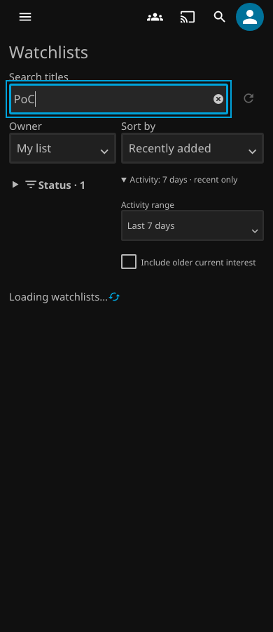
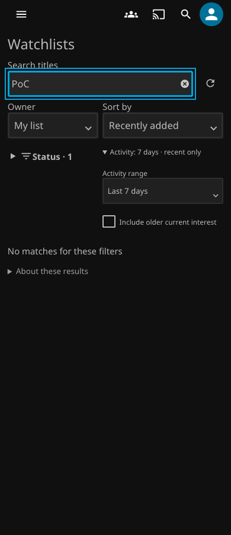
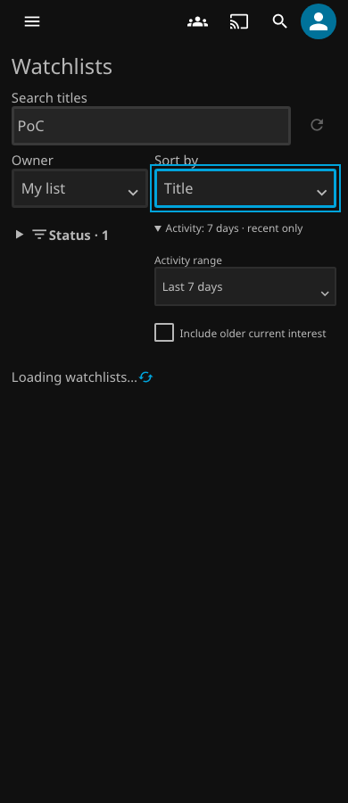
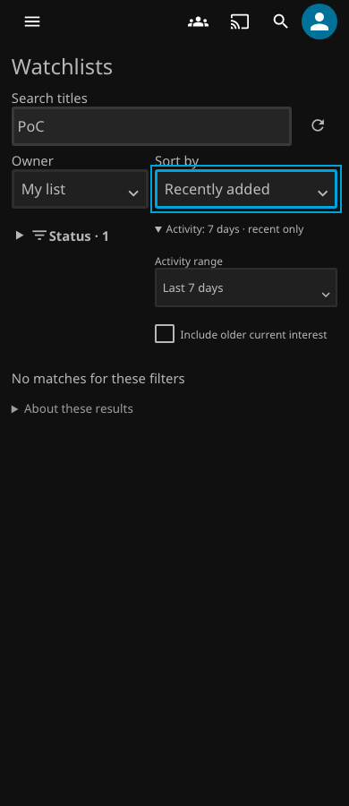

# Early Watchlists controls — v0.7.14 preparation

**Unpublished.** This patch fixes filter changes during account and preference initialization. Published packages and the public catalog remain unchanged.

## Cause and correction

The original Watched checkbox handler increments the query generation. This makes the initial `load()` obsolete. Before the first scope exists, `updateFilters()` does not start another load. A late preferences response is discarded, no membership or activity request follows, and the page remains busy.

[The failing baseline](evidence/early-filters-v0714/baseline.txt) invokes the actual checkbox handler in `progressiveFixture(true, true, null, true)`. It does not wait for initial readiness or call `updateFilters()` directly.

The page now shares pending account/preference initialization across filter changes. Each changed view gets a replacement load, including before the first scope exists. Only the latest generation can proceed to membership and activity requests. A completed initialization is released; later loads still obtain the account through the existing API.

A second race remained at `e25fc349`: after a completed Title view, a change to Recently added started account initialization. Returning to Title invalidated that load but matched the previous view signature. No replacement request followed. [The round-trip baseline](evidence/early-filters-v0714/roundtrip-baseline.txt) reproduces this through the actual Sort handler.

Each load now records its requested view and generation **before** initialization. The reload decision checks both. Changed views replace obsolete work, including a return to a previous value. Equivalent updates retain a valid request. Control handlers no longer invalidate work before the route applies the change, so an unchanged URL cannot strand a load or poll. Preferences still resolve through the shared initializer.

Controls display their initial values immediately. An unrelated control preserves an explicit owner URL while account verification is pending. Late defaults fill only absent URL/control values. Filtering sends no preference writes. The 250 ms search debounce, serialized activity requests, four-request preparation budget, 30-second visible-page poll, account/route fences and authorization clearing remain intact. Removal feedback and navigation handoffs are unchanged.

## Validation

Fast regressions cover deferred account, preferences and data responses; real control handlers; rapid changes; explicit URL precedence; search debounce; account/navigation cancellation; authorization and transport failures; refresh recovery; serialized requests; and polling limits. Existing removal-error assertions remain mandatory.

The shared native regression holds the real preferences GET, then changes status, sort, owner, range and search through browser controls. It observes frames during the transition, checks panel identity and focus, and asserts the exact final query. It runs at 1280px and 390px in current Chromium and real Chromium 79. The test also verifies that no preference write occurs.

The native regression then holds the next `ApiClient.getCurrentUser()` promise after data has loaded. This is a test wrapper around the real native result, because Jellyfin can cache the lookup. Actual Sort events perform Title → Recently added → Title; a second case uses browser Back, and a third repeats an equivalent value. Each case requires one shared account lookup, one membership request, bounded activity preparation, the correct final sort, retained focus/disclosure/panel identity, and no exposed Home frames. Unit tests also cover equivalent updates in all four loading phases and during a poll.

| Preferences held; controls remain usable | Latest selected view finishes loading |
| --- | --- |
|  |  |

| Return to Title while account lookup is held | Final selected view finishes loading |
| --- | --- |
|  |  |

The [initial PR evidence](evidence/early-filters-v0714/results-initial.json) is retained as superseded evidence. Its package hashes do not identify this correction.

Exact package identity and completed scenario results are recorded in [the evidence summary](evidence/early-filters-v0714/results.json). The qualification policy remains unchanged. After merge, automatic master qualification must validate the exact v0.7.14 package before release approval.

## Limits and test-development failures

The native checks use disposable Jellyfin data and browser emulation on macOS. Chromium 79 is an actual `79.0.3945.0` executable; it is not a changed user agent. Physical LG TV testing remains necessary. On the TV, open Watchlists and immediately change Status, sorting, range and search. Confirm that the selected view loads, Back works, focus remains visible, and filters are not saved unless requested.

The first native test setup reused an already initialized Watchlists page. The corrected setup leaves for Home before the held-request scenario. The pinned Puppeteer driver also rejected a combined shortcut and did not select text with its macOS modifier sequence. The test now uses ordinary Backspace presses. Original failure logs and fixture artifacts remain local; no retries, sleeps, increased timeouts or weaker assertions were added. The first backend run identified one stale assembly-version assertion, which now expects v0.7.14.

These focused branch checks do not replace the required post-merge qualification or authorize publication.
