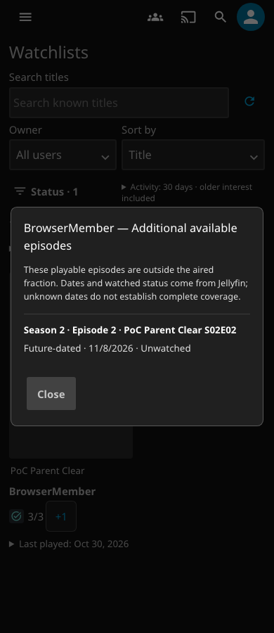
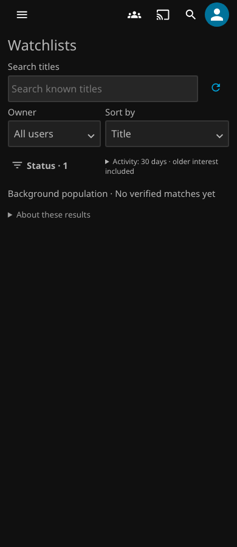

# v0.7.15 extras qualification investigation

[Latest deterministic validation](#deterministic-pending-path-correction) is recorded below; prior investigation evidence is retained.

This is a test-only change. The v0.7.15 runtime, version, published catalog, release assets, workflow requirements and token permissions are unchanged.

The [failed qualification](https://github.com/MajorSchloch/jellyfin-plugin-watchguard/actions/runs/41336407691/attempts/1) tested commit `7c63b26afb2215130c12a479915ffb361abfd8bc`. Job `124937483105` passed the desktop extras check, then timed out on the 390px check for BrowserMember on **PoC Parent Clear**. Artifact `13095637537` shows “No matches for these filters.” Its trace does not contain the ActivityBrowser response.

The exact cause of that CI response remains unconfirmed. The [unmodified local sequence](evidence/extras-qualification-v0715/baseline/extras-activity.json), with diagnostics added, passed on the pinned 12.3 `/jellyfin` fixture. Both Refresh clicks issued `refresh=true`. Playwright waited for the initially disabled control. Both indexed results agreed with the fresh APIs: Caught Up, 3/3 aired episodes, one future unwatched extra. No fixture data changed between those desktop and mobile iterations.

A separate controlled experiment confirmed a test synchronization defect. A native metadata update invalidated the index without changing the expected episode classification. The accepted Refresh returned HTTP 200 with an empty target result, `PendingVerification` and `PopulationPending=true`. The old `aria-busy=false` condition succeeded. The extras assertion then timed out before the next normal poll. Fresh ActivityOverview and SeriesActivity results still reported Caught Up and 3/3 +1. See the [captured responses and fresh classification](evidence/extras-qualification-v0715/controlled-baseline/extras-activity.json).

This controlled response differs from the original screenshot's plain empty state. It establishes the synchronization defect, not the missing original response. No incorrect current indexed classification was demonstrated. An unexplained empty result must still fail.

The revised check waits for an enabled Refresh control and observes its actual `refresh=true` response. It verifies the exact title/member IDs, Caught Up reason, 3/3 aired counts, and one future unwatched extra. Only a response with both pending-verification signals permits a wait for one normal 30-second UI poll. The 45-second bound covers that scheduled poll; it does not change the existing card timeout. The first matching poll response is checked, even if wrong. There are no repeated Refresh clicks or repeat-until-success requests. The ordinary native cases do not substitute server responses.

The browser fixture retains the ordinary 1280px and 390px checks. A separate third iteration holds initial loading, activates Refresh with a real pointer while disabled, and verifies that it issues no extra refresh. It then supplies a test-controlled empty Refresh response with both pending signals. This response does not fetch from the server or mutate playback data. The next request passes directly to Jellyfin: exactly one ordinary background poll must restore the strict 3/3 +1 result. All original extras, focus, poster identity, overflow, membership, permission and deletion assertions remain intact.

The former controlled scenario relied on a playback POST leaving the indexed row pending until `route.fetch()`. That assumption was unsafe: `RequestRefresh` can cause `IndexWorker` to re-enqueue and verify the row immediately, bypassing the two-second debounce. A valid, already-settled native response could therefore fail that test. Explicit response control removes this timing dependency. It tests pending-state presentation and normal polling, not native index invalidation. Ordinary desktop and mobile checks still test native classification without interception or intervening playback mutations.

`extras-activity.json` is written before assertions. It contains the selected query fields, response status, target-only results, coverage flags, index freshness and fresh on-demand classification. It records Refresh acceptance and UI state. Response samples identify their source as `native` or `test-controlled`; fresh API inspection is marked `native-on-demand`. The controlled response has a test-only identifying header, whose value is projected into the source label. Credentials, request headers, continuation values, opaque browser revisions and unrelated titles are excluded. Unit tests also verify this projection.

A development version of the new delay fixture removed interception before it fulfilled the held request. That run failed with `Route is already handled`. Cleanup now occurs after the controlled flow. It is recorded as a development failure, not a passing validation result.

Earlier validation, before the deterministic response correction, tested commit `63c6cc71e920bfaf9e179e4d7c97e5c4b4cd9f2f`. The complete `/jellyfin --proxy` browser fixtures passed on Server/Web 12.3.0 and 12.4.0, including their remaining security and uninstall checks. Elapsed times were 443.937 and 443.841 seconds. Fast checks passed: 304 JavaScript, 376 .NET, 120 Python and eight catalog tests.

These earlier results and exact identities are retained in [validation.json](evidence/extras-qualification-v0715/validation.json). The package matches artifact `13094943539` from the failed qualification:

- ZIP SHA-256: `40b81b2b0ec716b3834085a31d7eab3ed4f9752e3b54a9307333462976897db2`
- DLL SHA-256: `545c591ef8bc1926f03122ab75c89fbd490876a34e942d4d8c042a2ebbd9a834`

The package and its sidecar were verified before fixture use. Deterministic packaging reproduced the same ZIP. The packaged ES2019 checks cover all five browser assets, settings inline code and startup concatenation. No runtime change warrants a new return-position or Chromium 79 native run for this PR. The existing qualification policy remains blocking and runs automatically after merge; these focused checks are not a release qualification record.

In that earlier timing-dependent experiment, the controlled UI was still empty after native verification finished. One ordinary poll restored the target after 30.047 seconds on 12.3 and 30.026 seconds on 12.4. Each controlled case issued exactly one accepted Refresh. The original two viewport iterations still run without intervening fixture mutations.

| 12.3: response completed, background snapshot still pending | 12.3: first ordinary poll restored 3/3 +1 |
| --- | --- |
|  |  |

The [12.4 response record](evidence/extras-qualification-v0715/12.4/extras-activity.json) and [screenshot](evidence/extras-qualification-v0715/12.4/extra-card-390-delayed.png) show the same sequence. These are local headless Chromium 141.0.7390.37 tests with locked Playwright 1.56.1 on macOS arm64. They are not physical-TV tests or a complete CI qualification. The local Node version was 25.9.0; the unchanged CI environment uses its pinned Node version.

## Deterministic pending-path correction

The corrected tests are committed at `297974b2fbdcc936b307f20368a4f319fbd9fdbe`. Current validation is recorded separately below; earlier evidence is retained unchanged. Unit coverage rejects unexplained empty results, either pending signal alone, incorrect member/progress and a failed first poll. It also verifies that the controlled response cannot call `route.fetch()` and accepts an already-settled native result in the ordinary path.

Both complete pinned `/jellyfin --proxy` fixtures passed on this test commit, including the remaining security and uninstall checks. See the [new validation record](evidence/extras-qualification-v0715/deterministic/validation.json) for exact package identities and image digests.

| Server/Web | Complete fixture | Browser actions | Controlled response to native poll |
| --- | ---: | ---: | ---: |
| 12.3.0 | 440.22s | 397.443s | 30.034s |
| 12.4.0 | 439.47s | 397.104s | 30.051s |

Each controlled case issued exactly one accepted Refresh and one ordinary native poll. Both ordinary native viewport cases passed without response substitution. Fast validation passed: 306 JavaScript, 376 .NET, 120 Python and eight catalog tests. Deterministic packaging reproduced the unchanged hashes above, and packaged ES2019, policy and release/catalog checks passed.

| Test-controlled pending state (12.3) | Native poll restores 3/3 +1 (12.3) |
| --- | --- |
|  |  |

The [12.3 response record](evidence/extras-qualification-v0715/deterministic/12.3/extras-activity.json) and [12.4 response record](evidence/extras-qualification-v0715/deterministic/12.4/extras-activity.json) explicitly separate supplied responses from native results. This is browser-fixture evidence, not physical-TV testing. The original CI failure remains unconfirmed.
