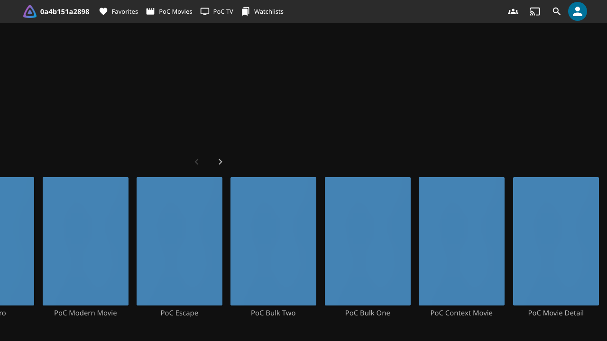
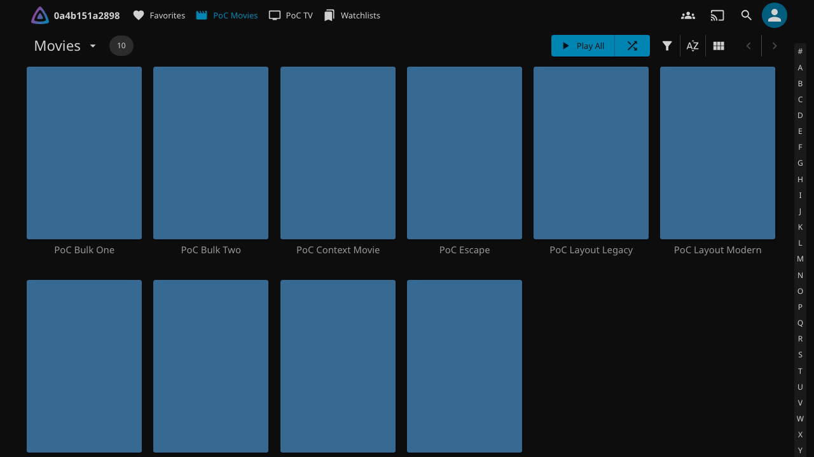

# Native menu navigation regression

The old `movies()` helper accepted “PoC Bulk One” anywhere in the document. Home can already show that item. Its global `card()` locator could therefore open a menu on Home while native Movies navigation was pending. The pending route change can invalidate the menu's route context before WatchGuard attaches its command.

The test now requires the expected `#/movies` route, library ID, collection type, and the active, visible `moviesPage`. Native `viewshow` and `viewbeforehide` events identify the active view. Cards must belong to that view and match the fixture's title, item ID, media type, server ID, and detail link. The route/view contract is checked again before the action.

## Deterministic reproduction

`tests/movies-navigation-regression.cjs` holds the actual native Movies module request. The same synthetic movie appears on native Home and Movies. While the request is held, the test executes the old helper's title and adapter conditions. Both succeed on Home. The new helper remains blocked. After the request is released, Movies becomes active, the item identity checks pass, and its native WatchGuard menu opens.

The regression runs inside `browser-poc.cjs`, before its existing membership, stale-menu, authorization, deletion, bulk-selection, and account-cleanup assertions. It uses no artificial view, fixed sleep, retry, or longer timeout. Fast tests also reject a wrong route/library, hidden or inactive view, wrong item/server/type/link, duplicate cards, and a route change before an action.

| Held native transition: old helper accepts Home | Native Movies ready: scoped action permitted |
| --- | --- |
|  |  |

## Validation

Results and package identity are recorded in [the evidence summary](evidence/native-menu-navigation/results.json).

The affected scenarios in `scripts/qualification-policy.json` are `basepath-full-browser` and `previous-stable-upgrade-caddy`, on both 12.3 and 12.4. These exercise the full native browser script, not an isolated replacement for its safety checks. The direct upgrade uses the verified published v0.7.12 package and installs the unchanged v0.7.13 package.

Fast checks cover JavaScript, Python, backend tests, catalog validation, policy consistency, release notes, deterministic packaging, and packaged ES2019 parsing. No plugin source, version, catalog entry, or published asset changes.

## Limits

These are disposable native Jellyfin fixtures with headless Playwright Chromium on macOS. They are not physical-TV checks. The held module request makes the reported race deterministic; it does not prove that every historical native-menu timeout had this cause. No full release matrix or publication is required for this test-only correction. Other policy suites remain unchanged and blocking.
