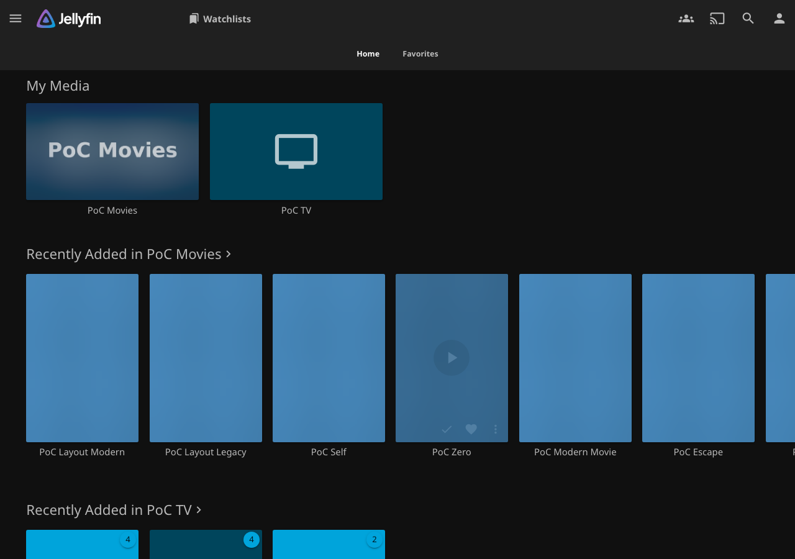
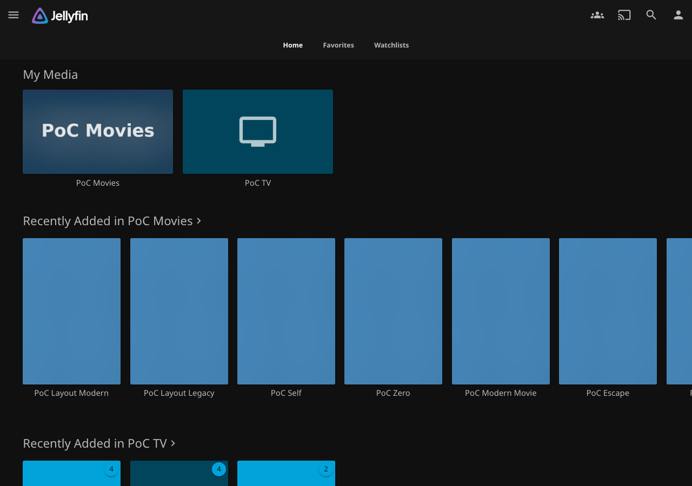
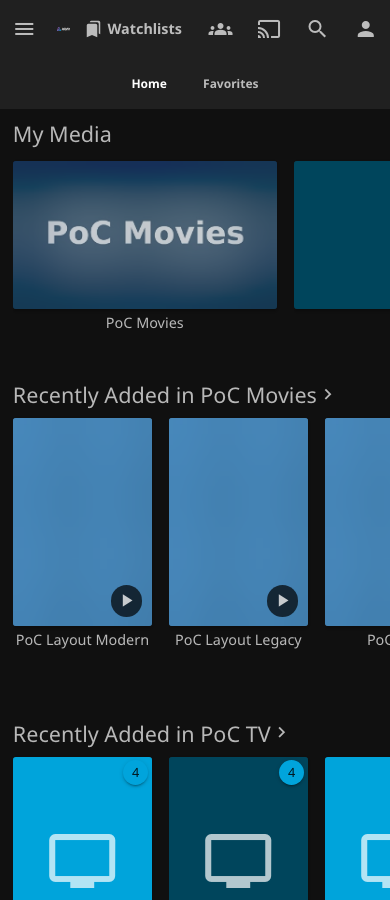
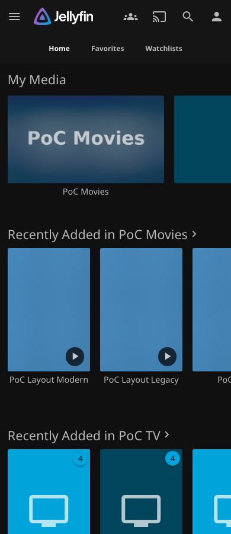

# WatchGuard v0.7.9 native navigation

## Reproduced cause

The released v0.7.8 runtime inserts a Legacy header link into `.headerLeft`, beside the logo, while Home/Favorites live in `.headerTabs`. On Mobile Legacy this also compresses the logo. The previous drawer tests selected Modern and narrow Desktop Legacy, never the actual `mobile-legacy` layout.

The new `navigation-shell-browser.cjs --baseline` test ran against the unchanged v0.7.8 DLL on the digest-pinned Jellyfin 12.4 fixture. Both Legacy modes failed the same-row assertion at 1280px and 390px. Auto and Modern retain their existing toolbar/drawer behavior.

## Integration choice

Packaged Jellyfin Web's `emby-tabs` controller indexes `.emby-tab-button` elements and parses `data-index` during click handling. WatchGuard therefore adds a sibling anchor alongside that controller, with no native tab class or index. Its font and padding come from the native Favorites button; scoped CSS uses Jellyfin theme variables for secondary, selected and hover colors. Home and Favorites keep indexes 0 and 1, native event handlers and scroller ownership.

Legacy has one persistent entry in each navigation surface: header and drawer. The closed native drawer hides its entry. Opening it no longer removes the header anchor or recenters the native tabs. Drawer links use native `navMenuOption`, icon/text slots and selected styling; native click delegation closes the drawer. Leaving Watchlists through a Legacy Home/Favorites button follows the corresponding existing Home URL after native click handling, including when Home was already selected beneath the overlay.

There is still no supported runtime plugin-tab registration API. This is a bounded DOM integration with known native slots, not a replacement router. No generated CSS classes, pixel positioning, native tab index changes, new polling intervals or API requests are added. The existing startup handoff, filter replaceState behavior, query lifetimes, authentication and account clearing remain intact.

## Validation

Qualification pending. Tests select the actual `auto`, `desktop-legacy`, `mobile-legacy` and `modern` layout values, and assert the rendered shell and mobile layout class. Coverage includes native drawer rows, geometry, duplicate entries per surface, header identity/position through drawer opening, native tab exit behavior, direct links, reload/hard reload, Refresh, filters, rapid changes and browser Back/Forward. Existing startup frames are observed before bootstrap and during delayed requests.

All browser evidence is headless Chromium with viewport/touch emulation, not physical-device testing. Custom CSS/themes, other browsers and TV are not newly qualified. Both Legacy modes retain a header fallback on routes without Home/Favorites, such as item details.

Public catalog, published packages, ABI and dependencies remain unchanged. Release copy is separate in [v0.7.9 release notes](releases/v0.7.9.md).

## Before and after

Released v0.7.8 on the left; v0.7.9 candidate on the right. Synthetic Jellyfin 12.4 library, Chromium emulation.

| Layout | Before | After |
| --- | --- | --- |
| Desktop Legacy, 1280px |  |  |
| Mobile Legacy, 390px |  |  |

[Open Mobile Legacy drawer](screenshots/navigation-v079/after-mobile-legacy-390-drawer.png) · [Keyboard focus](screenshots/navigation-v079/after-mobile-legacy-390-selected-focus.png) · [Auto desktop](screenshots/navigation-v079/after-auto-1280-home.png) · [Auto drawer](screenshots/navigation-v079/after-auto-390-drawer.png).
