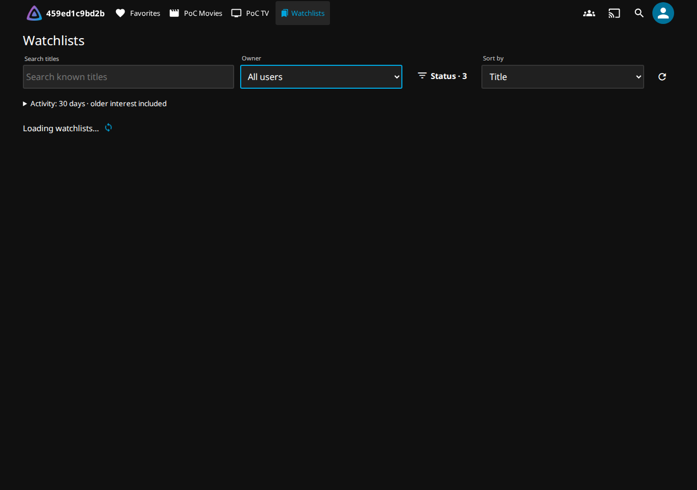
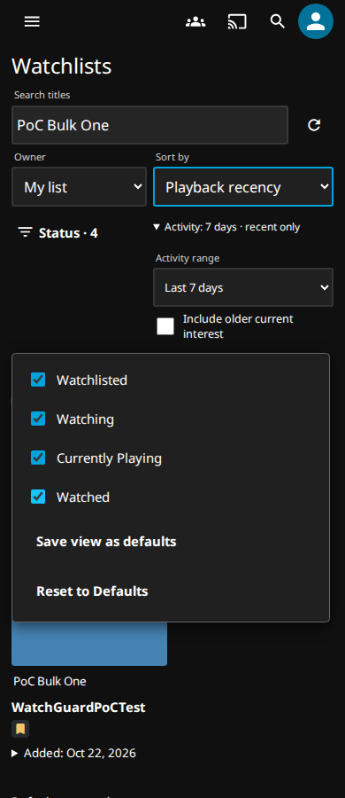

# Watchlists filter navigation — v0.7.2

Unpublished patch based on published v0.7.1, master `8d1d801`. The public catalog,
release assets and historical qualification evidence remain unchanged.

## Reproduction and scope

The unchanged master package reproduces published v0.7.1 byte-for-byte:
SHA-256 `1f185fafdb3bcc024db420a3502eddc43ac6f81414587de39e445ec8db52bce6`.
Reproduction uses the existing disposable Jellyfin Server/Web 12.2.0 image,
synthetic media/accounts and the real native Web router. No production data or
server is involved.

`change()` and the debounced search call the navigation callback installed by
`updateNavigation()`. Reset reaches that same callback after deleting the saved
preferences. The callback assigns `location.hash`, creating a browser history
entry and dispatching `popstate`/`hashchange`. Jellyfin's native router processes
the resulting Home-route query change. The existing unit fixture called
`updateFilters()` directly, so it could not observe that route transition.

Initial observations of the unchanged runtime recorded 36 native router updates
across 32 control operations in legacy/modern layouts at 1280px/390px.
Reset also lost focus while its button was disabled. The regression failed on
the first unexpected hash event. WatchGuard's panel remained connected: the
captured fixture did **not** show Home painting above it or a native loading
overlay. Thus the unnecessary native routing and Reset focus loss are reproduced;
the production report's visible Home flash is not independently reproduced in
this fixture. The fix removes that routing path, rather than hiding native UI
with additional CSS. This distinction is retained in the PR evidence.

The final identical transition fixture was then run against both packages: the
published baseline fails with **48 native route updates across 36 operations**;
the candidate passes with **zero native route updates**, no panel replacements
and no focus loss. The baseline loses focus in all four Reset cases and discards
Jellyfin's initialized history state on the first filter change in each shell.
The candidate preserves that state. Both keep ActivityBrowser requests serialized
(maximum one in flight). See the [local comparison](evidence/navigation-v072/local-comparison.json),
[baseline failure](evidence/navigation-v072/published-v071-transitions.json) and
[candidate result](evidence/navigation-v072/local-v072-transitions.json).

## Navigation contract

Filter changes replace the current Watchlists history entry with
`history.replaceState(history.state, '', hash)` and synchronously call the
existing navigation reconciliation. Jellyfin's router-owned state is preserved
verbatim. No synthetic route event, patched router/history API, extra listener,
request or timer is introduced. The existing panel applies the URL via
`updateFilters()`; loading stays in that panel.

Back leaves Watchlists for the previous page, rather than stepping through each
filter or search term. Forward restores the latest filters. Reload and shared
links read the same URL. Opening item details, returning, and leaving for Home
or Favourites remain ordinary native navigation.

Reset keeps its focusable button while exposing `aria-disabled` and ignoring
repeat activation during the request. Its DELETE, default values, error handling
and account fencing are unchanged. Search debounce, saved defaults, query
cancellation/serialization, preparation, authorization clearing and polling
remain unchanged.

## Transition regression

`tests/navigation-browser.cjs` drives actual controls through the installed Web
adapter. It observes DOM mutations and animation frames from activation until
at least 1.1 seconds after settlement. It checks painted hit targets within the
panel for Home/overlay exposure, panel identity, focused control, relevant open
disclosures, native router diagnostics, browser events, history length/state,
loading frames and serialized query work. Delaying each real ActivityBrowser
request by 350ms makes loading observable without substituting API responses.

The matrix covers legacy and modern shells at 1280px and 390px: owner, status,
sort, activity range, older interest, search, rapid search, rapid cross-control
changes, and Reset. Ordinary changes must issue exactly one initial query;
rapid changes retain bounded serialized work. Relevant open disclosures persist;
clicking outside the Status popover still intentionally dismisses it.

The fixture also checks Back/Forward, reload, a shared URL in another tab, item
details and return, and the native Home/Favourites links. The full qualification
runs this fixture through `/jellyfin` behind the disposable proxy, in addition
to the unchanged security, polling and activity-browser suites.

These are Chromium fixture observations, not production-browser or device
traces. Frame sampling cannot prove absence of every possible compositor-only
flash; routing events and panel/focus mutations are observed separately.

## Qualification

[Full qualification](https://github.com/MajorSchloch/jellyfin-plugin-watchguard/actions/runs/39777757932) passed the build and all eleven integration
suites with `publish=false` and `proxy_matrix=true`; the publish job was skipped.
The exact tested runtime and fixture commit is `8c7ada700d13a017e2b70534b5ec56118c5bff49`.
Later evidence commits change only documentation, JSON evidence and screenshots.

Candidate ZIP SHA-256: `15520d8786a47c03440bb3718115d351e73e51deb16e9fa4ff2f38f2547f0554`.
The local build, deterministic rebuild and downloaded CI artifact match.
[Exact provenance](evidence/navigation-v072/qualification.json) records the jobs,
artifacts, DLL checksum and screenshot checksums.

Checks passed: **288 backend, 171 JavaScript, 19 infrastructure and 4 catalog**.
The [qualified native transition report](evidence/navigation-v072/qualified-native-transitions.json)
passes all 36 operations and ordinary navigation through the `/jellyfin` base
path and disposable proxy. It records zero native route events, Home/overlay
exposures, panel replacements, focus loss or unintended disclosure closure.
Every ordinary control issues exactly one initial query, router state/history
length are unchanged, and query requests remain serialized. The existing
activity-browser, account-switching, authorization and security regressions also
pass. [Proxy matrix](evidence/navigation-v072/proxy-compatibility.json) and
[native remote-access policy evidence](evidence/navigation-v072/native-remote-access-proxy.json)
are retained separately.

The first dispatched workflow was deliberately cancelled to update two older
Back/Forward assertions to the new history contract; it is not counted as a passing qualification. The final run above
includes those corrections and the archived-version history assertions.

