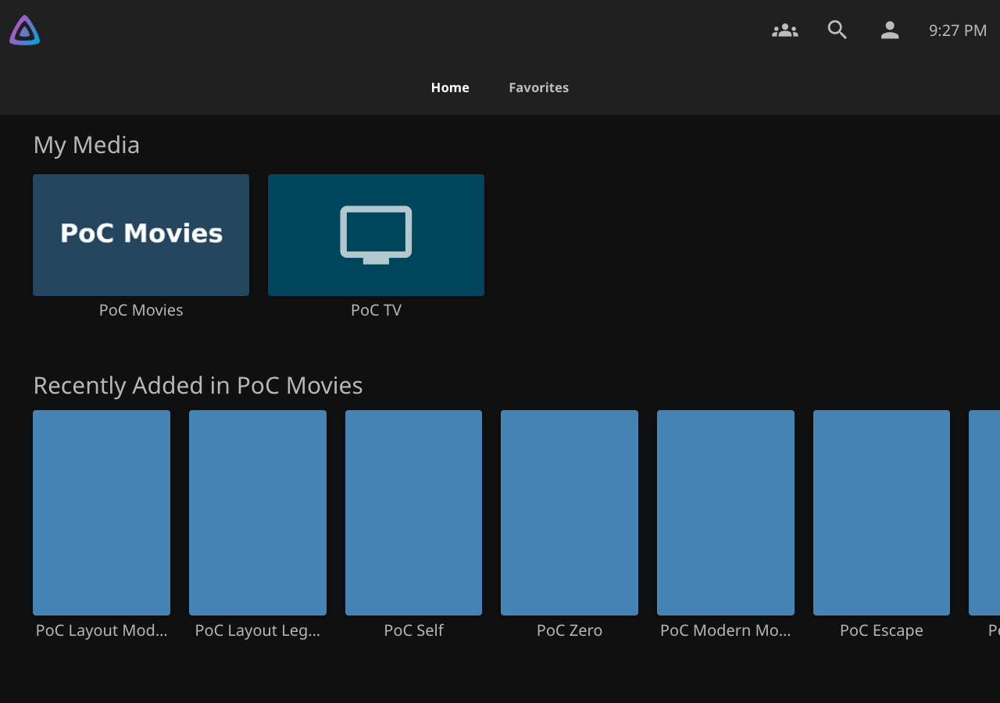
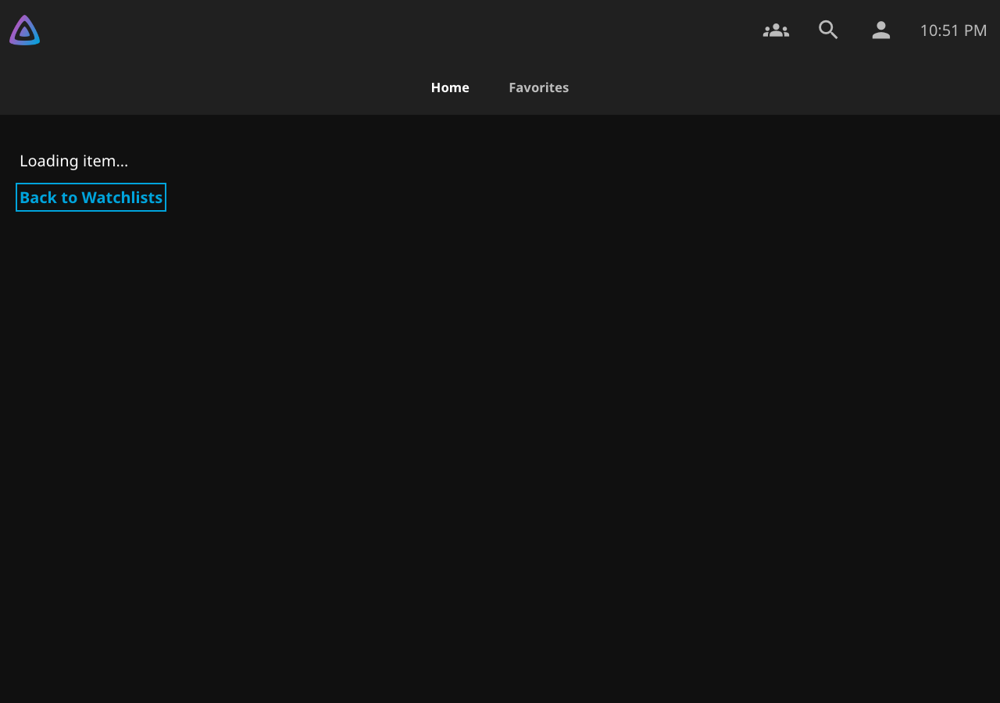

# Watchlists to native item details

The installed v0.7.12 report came from LG webOS 6.5.3-47. This fix concerns departure from Watchlists. Publisher recovery and the preferences-initialization race remain separate work.

## Reproduction and cause

The disposable Jellyfin 12.4 fixture reproduced the flash in real Chromium 79.0.3945.0. The test activated a real series card with remote Enter/OK and held native destination requests. It sampled rendered frames and native lifecycle events, rather than only the final page.

At `hashchange`, the old runtime removed the Watchlists panel and `watchguard-page-open`. Native Home remained visible before `viewbeforehide` and the detail view's `viewbeforeshow`/`viewshow`. The initial observation recorded two Home frames. With the detail-chunk request held, the published package exposed Home in 53 of 60 sampled frames. The same assertion fails before the fix and passes after it.

The native detail controller also starts its item-data load from `viewshow`. Thus, `viewshow` alone does not establish that the requested item's controls are ready. The inspected native Web assets use the same detail structure on supported Jellyfin versions: `itemDetailPage`, `.nameContainer` and `.mainDetailButtons .btnPlaystate` with item/server attributes.

## Handoff contract

WatchGuard places a neutral, scoped “Loading item…” cover before it removes Watchlists. It then aborts the Watchlists lifetime immediately. Poll/search timers, queued work and owned listeners stop; response-generation and account fences reject late results. Already dispatched native ApiClient requests can finish because that API exposes no transport abort handle. The cover makes no data requests and retains no titles, owners, progress or membership data.

Native content stays laid out behind the cover. No ancestor is hidden for a visibility check, so WatchGuard cannot prevent its own readiness condition.

Release requires all of these conditions:

- The current route is the exact pending detail route.
- The ApiClient object, user, access token and server still match the captured account.
- A native `viewshow` identifies the pending item and server on the connected `itemDetailPage`.
- That view is not hidden, has layout boxes and contains its rendered title.
- Its native play-state control carries the matching item and server IDs.

A generic event, unrelated item, stale route, detached view or old rendered control cannot clear the cover. Mutation observation handles item rendering after the matching lifecycle event. The cover does not use an elapsed delay as a success condition.

The native focus manager can select its detail control while the cover is present. WatchGuard temporarily keeps covered content out of remote focus, then restores that same native control. Header focus remains undisturbed. The visible return link remains available during loading. Native Back/Forward and history continue to own routing.

A navigation sequence has one 15-second cleanup deadline. Retargeting does not extend it. On expiry, WatchGuard removes the full cover, stops its observer/listener and shows a compact failure notice with a return link. This is failure recovery, not a declaration that the destination is ready. Account changes, logout, navigation away and document exit clear owned temporary state. A return to Watchlists uses the existing incoming handoff.

## Validation

`tests/outgoing-browser.cjs` runs against a disposable server and actual packaged scripts. It uses Puppeteer 2 with a real Chromium 79 binary when `WATCHGUARD_CHROMIUM79` is set; otherwise it uses the pinned Playwright browser. It is part of the existing base-path navigation qualification scenario on Jellyfin 12.2, 12.3 and 12.4. Existing startup and navigation suites remain required.

The cases cover TV, Desktop Legacy, Mobile Legacy, Modern and Auto; movie and series cards; remote OK, mouse and touch; held destination requests; Back/Forward; cancelled navigation followed by another selection; failure cleanup; authenticated account switching and logout. Tests assert prompt Watchlists teardown, no Home frames, matching native detail readiness and TV destination focus.

Unit tests independently reject mismatched lifecycle/item/server/account state, hidden or detached destinations and extended deadlines. They check listener/observer cleanup, failure recovery and preservation of header focus.

Browser emulation is not physical-TV validation. On the LG device, open a movie and a series with OK, use Back during loading, then repeat with a slow server connection. Confirm that loading stays inside the transition, focus reaches the detail controls, and Back returns to Watchlists. Pointer remote behavior, firmware-specific input handling and suspend/resume still require the physical device.

The deadline cannot repair a native destination failure. It provides a visible return action. Native ApiClient transport completion remains bounded by Jellyfin; WatchGuard cancels subsequent work and rejects stale results without replacing that transport.

## Local evidence

[Before-fix report](evidence/outgoing-handoff/baseline.json), [Chromium 79 report](evidence/outgoing-handoff/chromium79.json) and [current-browser report](evidence/outgoing-handoff/current-browser.json) retain sampled frame counts and lifecycle order. Both corrected browsers passed ten movie/series cases, with zero Home exposures during departure, Back and Forward. Authenticated account switching, logout, cancellation and bounded failure recovery passed.

| Published v0.7.12, destination held | Corrected runtime, destination held |
|---|---|
|  |  |

[Native TV detail and focus](evidence/outgoing-handoff/after-tv-detail.png), [mobile loading](evidence/outgoing-handoff/after-mobile-loading.png) and [failure recovery](evidence/outgoing-handoff/failure-recovery.png) show the remaining states.

The final local package contains the corrected runtime but retains version 0.7.12 pending the candidate-version decision. ZIP SHA-256: `6808ae967ac25f945fde70c2e16c959616b6ed3f69be0afaf6d5fc8295a7afaa`. DLL SHA-256: `f08da50ba8b578ce28c33f3c6e81de57644cd06a3d26a201c7378426b3a902cd`. These are development artifacts, not replacements for the published v0.7.12 assets.

The retained incoming-startup suite passed 48 transition cases and 14 recovery cases. The existing navigation suite passed 72 control-transition cases. Fast checks passed 214 JavaScript tests, 94 Python tests, eight catalog tests and 376 backend tests. The initial fast run exposed stale current-release labels on master after v0.7.12 publication; those labels now match the existing catalog. No catalog entry changed.

## First CI attempt and fixture correction

[Run 41239515881, attempt 1](https://github.com/MajorSchloch/jellyfin-plugin-watchguard/actions/runs/41239515881) tested commit `aeb86547668d85bc9254c7b2e2f62a48cb7bc819`. Its CI package artifact `13057155527` matched the local ZIP and DLL hashes above. All integration jobs except the three navigation jobs passed; the complete evidence gate did not run. This attempt is not a successful qualification.

The first native card transition timed out on each version. A local reproduction in the pinned Linux browser image found its default language was `en-US@posix`. Jellyfin's native `Number.toLocaleString` rejected that language tag during control construction, before the detail lifecycle. The new test now selects `en-US`, as the existing native suites do. [The original Linux reproduction](evidence/outgoing-handoff/linux-fixture-failure.json) retains the error and lifecycle evidence.

The added diagnostics also found that a fabricated `viewshow` event invoked Jellyfin controllers without their required view/options data. The browser suite now uses only actual native lifecycle events. Isolated unit tests retain the malformed and unrelated event rejection assertions. The browser test records script/request errors and failed-transition frames, and rejects script errors during normal card navigation. Neither correction changes runtime code, package bytes, timeouts or the strict Home/focus assertions.

After the fixture correction, the pinned Linux Chromium 141 browser and real Chromium 79 each passed all ten cases on Jellyfin 12.3 with the base path. Every normal departure, Back and Forward sample had zero Home exposures. The Linux browser used `en-US`; normal card transitions had no script errors. The intentional HTTP 503 case still exercised the native chunk-load failure and bounded recovery.
