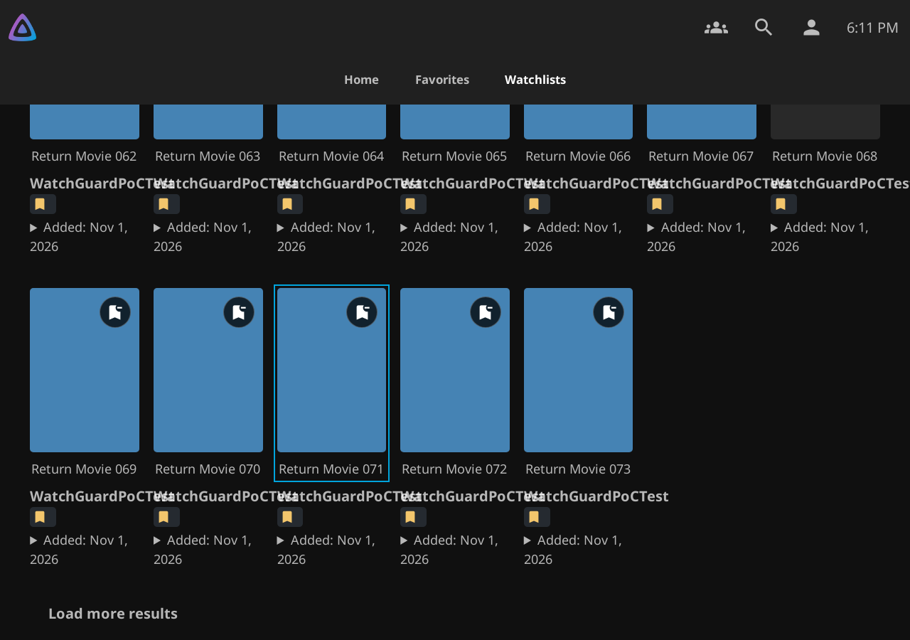
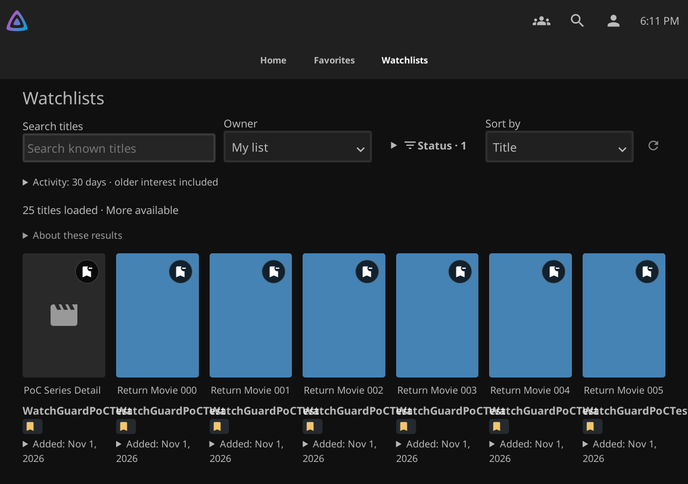

# Watchlists return position — v0.7.15 (unpublished)

Baseline reproduction at `049ff507` uses the unchanged runtime from master `2ad7478`, actual Jellyfin 12.4, current Chromium 141 and actual Chromium 79.0.3945.0. All twelve desktop/mobile/TV, first-page/three-page cases returned to a new panel at scrollTop 0. Deep returns loaded 25 rather than 75 titles. Focus ended on BODY in every case, including TV: the toolbar focus call seen in source was not the final observed focus. Native hash entries had null history state. See [baseline measurements](evidence/return-position-v0715/baseline.json) and [native run](https://github.com/MajorSchloch/jellyfin-plugin-watchguard/actions/runs/41334937803).

| Before opening a deep title (Chromium 79 TV) | Baseline after Back |
| --- | --- |
|  |  |

Implementation and corrected validation are in progress. This is browser evidence, not physical LG TV testing. The current qualification policy, published assets and catalog entries remain unchanged; this branch does not authorize publication.
