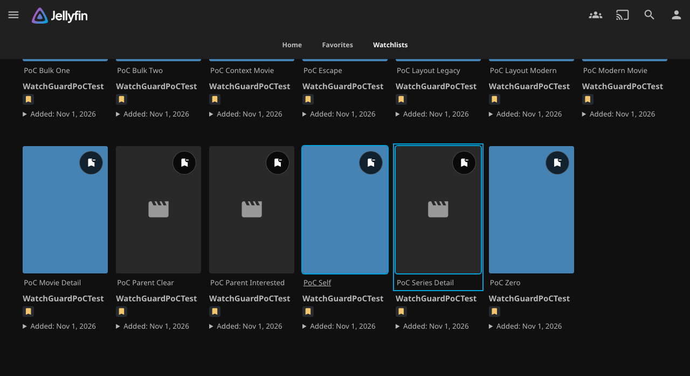
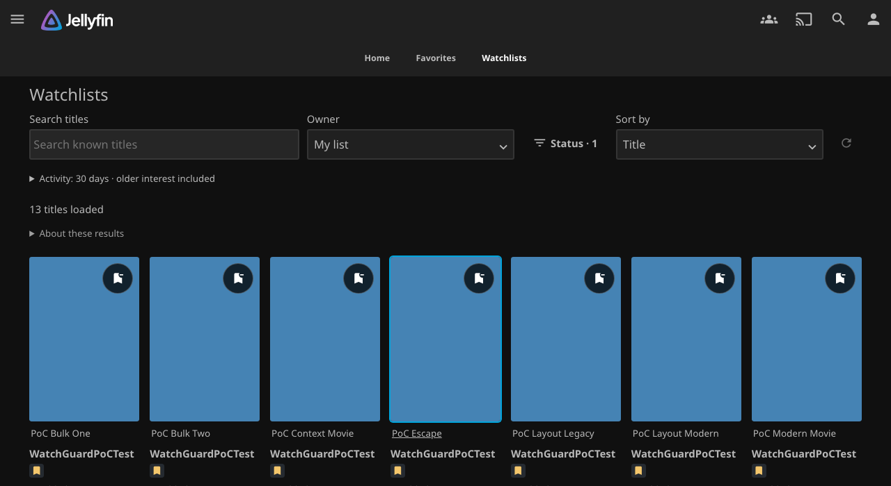
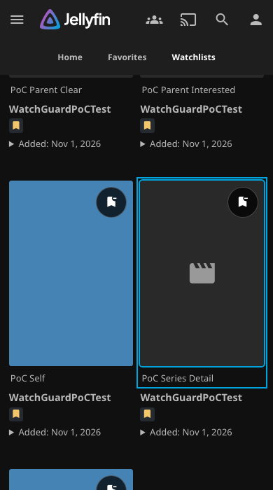
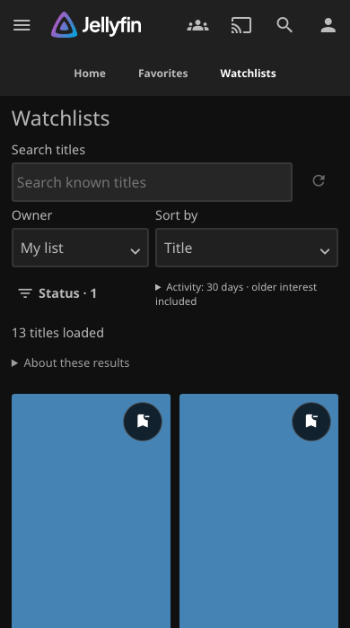
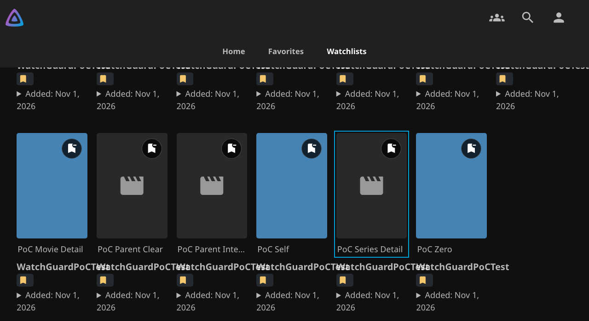
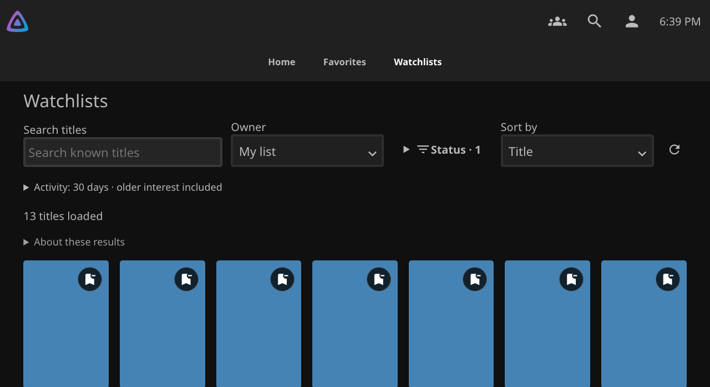
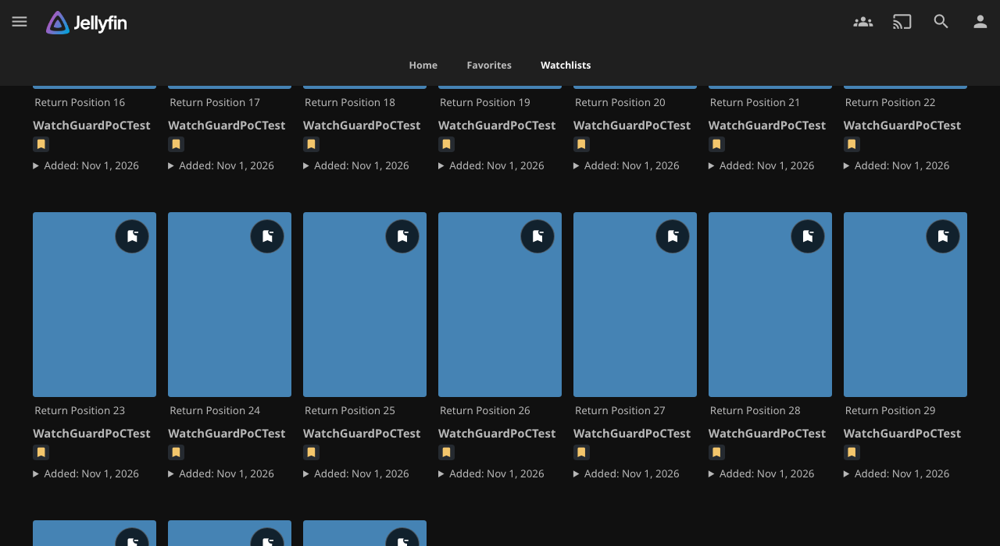
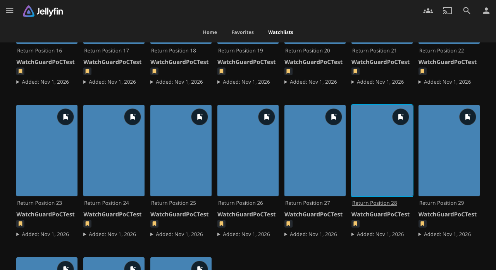
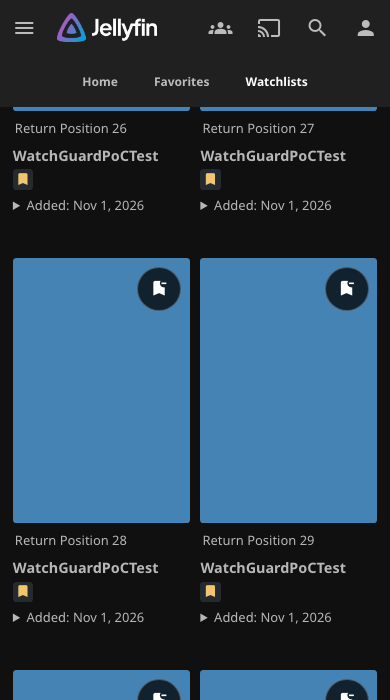
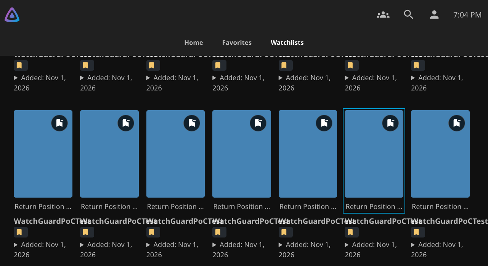

# Watchlists return position — v0.7.15 preparation

**Unpublished.** This patch restores the selected title, approximate scroll position and useful focus after a return from native item details. Published packages and catalog entries remain unchanged.

## Observed baseline

The native fixture ran the exact published v0.7.14 DLL, SHA-256 `1a0ceb832b36543d7c0217ebfe67038715a31d75a65a5727a84fec4c065e614e`. It opened a title from a scrolled Watchlists view, then used browser Back. The title remained in the returned results, but the panel returned to scroll position zero. Focus moved to `BODY` in all three cases. The fixture did **not** observe focus on the first toolbar control.

| Native layout and engine | Panel scroll before → after Back | Title top before → after Back | Focus after Back |
| --- | --- | --- | --- |
| Desktop Legacy, Chromium 141, 1280 × 700 | 493 → 0 px | 272.44 → 765.44 px | `BODY` |
| Mobile Legacy, Chromium 141, 390 × 700 | 2242 → 0 px | 257.86 → 2499.86 px | `BODY` |
| TV, actual Chromium 79, 1280 × 700 | 621 → 0 px | 289.67 → 910.67 px | `BODY` |

The [current-browser measurements](evidence/return-position-v0715/baseline/current.json) and [Chromium 79 measurements](evidence/return-position-v0715/baseline/chromium79.json) retain the engine, deployed DLL hash, item position, panel depth and focus evidence. These are observations from disposable native Jellyfin fixtures, not assumptions from source inspection.

| Before opening details | After Back on published v0.7.14 |
| --- | --- |
|  |  |
|  |  |
|  |  |

## Behavior and history

WatchGuard records a small navigation context before an item opens. It contains the stable title ID, viewport offset, loaded depth, title ordinal, focused action and effective query. A WatchGuard marker identifies the originating history entry. The marker preserves Jellyfin's existing history fields. Unsupported history-state shapes disable restoration instead of replacing native data.

Back to that entry creates a new Watchlists panel and fetches current, authorized results. When the title appears, WatchGuard restores its action focus and approximate viewport position. If the title moved in the current ordering, it uses that ordering and shows a brief explanation. It does not reorder results to reconstruct an old list.

Fresh visits remain normal entries. Back and Forward use native history. Filter changes retain the existing in-place URL behavior. The outgoing cover and incoming startup handoff remain separate from position restoration. Leaving Watchlists still aborts the page lifetime, removes its listeners, polling and panel, and rejects late responses.

## Bounds and privacy

The navigation memory retains at most **four contexts**, each for at most **ten minutes**. Contexts remain in memory for the current document only. They are tied to the API instance, account, authentication token, server, query and history entry. Identity changes and authentication denial clear them. The token only participates in the existing in-memory identity check; it is not added to the URL or history state.

No cards, owner rows, membership data, dates or continuation tokens are retained for restoration. A history marker cannot authorize cached content. Every returned page uses the existing account checks, query serialization and authorization rules. Detail and Watchlists `401`/`403` handling also clear the restoration memory.

The initial **four-request preparation budget** is unchanged. Restoration can make at most **two additional result requests**, reach at most **three loaded pages**, and never exceed the saved depth. It stops as soon as the title is available. Saved depth is a search bound, not a promise to replay every old page. Ordinary pagination still requires **Load more results**.

These limits bound work even if a title moved far down the result set. Restoration does not extend preparation, refresh expired continuations automatically, or follow a continuation that makes no progress.

## Interaction and fallback

Pointer, touch, wheel or keyboard input cancels automatic focus and scroll restoration. It also stops additional automatic page requests. An in-flight response may finish the current authorized view, but it cannot move the user afterward. Route, query, account and generation checks prevent late results from moving another view.

If the title is absent, the budget is exhausted, preparation pauses, or the query fails, the current authorized results remain usable. A short notice explains that the previous place could not be restored. The heading receives focus unless the user has already interacted. Normal filters and loading controls remain available. An expired continuation exposes the existing **Refresh this view** action instead of a replay loop.

The browser can clamp the requested offset near the end of a short page; the selected title still receives focus. A changed ordering can still restore the same available title. Removed or unauthorized titles disclose no remembered title text or membership. Removal errors, ordinary refresh, preparation limits, polling and deletion protection keep their existing behavior.

## Validation status

Runtime source commit: `acaa2741a06eb096038f32df05515fb8aab6b071`.

- ZIP SHA-256: `40b81b2b0ec716b3834085a31d7eab3ed4f9752e3b54a9307333462976897db2`.
- DLL SHA-256: `545c591ef8bc1926f03122ab75c89fbd490876a34e942d4d8c042a2ebbd9a834`.
- Two final packaging runs produced identical bytes. The [GitHub Linux fast-check package](https://github.com/MajorSchloch/jellyfin-plugin-watchguard/actions/runs/41334971057) also matches those bytes.
- **294 JavaScript, 376 backend, 120 Python and 8 catalog tests passed.** Release metadata, policy and public-catalog preservation checks passed. Packaged scripts passed ES2019 checks, including settings inline code and the startup concatenation.

| Final-package native check | Result |
| --- | --- |
| Jellyfin 12.4, Chromium 141, `/jellyfin` proxy | 72 existing filter/history transitions, 27 return cases and 10 outgoing handoff cases passed. |
| Jellyfin 12.4, actual Chromium 79 | Existing four-layout native suite and 11 return cases passed; zero JavaScript errors. |
| Jellyfin 12.3, Chromium 141, `/jellyfin` proxy | Core browser, preferences, membership/removal errors, deletion checks, account isolation and uninstall/data-retention checks passed. |

The 12 normal movie/series returns across Desktop Legacy, Mobile Legacy, Modern and Chromium 79 TV restored the title with **0 px measured offset difference**, correct title focus and **zero observed Home frames**. First-page returns used one `ActivityBrowser` request; deeper returns used two. These counts exclude the ordinary account, preference and membership requests. The native test deliberately holds return data, observes rendered frames, activates real cards with mouse/touch/Enter, and then uses native Back/Forward.

The native cases also cover removed membership, server-generated continuation expiry, user input, navigation away, fresh entries and account changes. Injected detail `401`/`403` failures are explicitly labelled and verify that return hints are cleared. The [validation record](evidence/return-position-v0715/validation.json), [current-browser returns](evidence/return-position-v0715/candidate/current/return-position.json), [navigation](evidence/return-position-v0715/candidate/current/navigation.json), [outgoing handoff](evidence/return-position-v0715/candidate/current/outgoing.json), [Chromium 79 returns](evidence/return-position-v0715/candidate/chromium79/return-position.json), [full Chromium 79 report](evidence/return-position-v0715/candidate/chromium79/report.json) and [12.3 core browser report](evidence/return-position-v0715/candidate/jellyfin123/report.json) retain the package identity and results.

| Before opening details | After Back on the final candidate |
| --- | --- |
|  |  |
|  |  |
|  |  |

Loading stays inside Watchlists: [mobile loading frame](evidence/return-position-v0715/candidate/current/mobile-loading.png), [TV loading frame](evidence/return-position-v0715/candidate/chromium79/deep-loading.png).

The larger 12.4 startup/navigation group also passed before the final history-marker cleanup: 48 startup, 48 arrival, 8 navigation-shell and 12 drawer cases, native controls/themes, outgoing and filter/history checks. That evidence is kept separately under [pre-cleanup](evidence/return-position-v0715/pre-cleanup/current/startup.json). It tested commit `5a0185c352689cfb1da5f358ab82cf9bfe436837` and ZIP `49f749bdae23d0b1dca9bd0c2d8f045f1df659f2ad6aaa5c7198017c11b3cb44`; it is not presented as a final-package startup run. The final navigation, return, outgoing and older-engine checks above were repeated after that cleanup.

Focused regressions cover first-page and deeper-list returns, history, delayed data, unavailable titles, bounded work, continuation expiry, account changes and user interruption. Existing startup, departure-cover, filter, permission and removal-feedback assertions remain required. The native fixture checks actual card activation and return behavior; screenshots alone do not establish correct transitions.

An early exploratory run shared a mutable fixture account between browsers. A removal scenario deleted the other browser's target. That [failed run](evidence/return-position-v0715/development/shared-fixture-interference.json) is retained and excluded from validation. Final checks use isolated fixtures. Review also found a deterministic same-route history-marker cleanup edge; a test now verifies that cancelling restoration cannot leave loading controls busy. This edge was not observed in native Jellyfin.

The current qualification policy remains unchanged: Jellyfin **12.4 full** and **12.3 core**, current Chromium and actual Chromium 79, with a direct upgrade from published v0.7.14. The minimum package ABI remains 12.2.0.0. It is not a claim of current native qualification on Jellyfin 12.2. No full branch matrix or additional historical matrix is required for these focused checks. After merge, automatic qualification must validate the exact master package before release approval.

## Physical TV check

Browser evidence uses disposable Jellyfin fixtures and desktop/mobile viewport emulation. The older-engine evidence uses an actual Chromium `79.0.3945.0` executable, not a changed user agent. No physical LG TV test has been performed for this patch. The TV screenshots also show an existing long synthetic username overflow between cards; card styling is unchanged and outside this patch.

On the LG TV:

1. Open Watchlists and move focus to a movie or series below the first visible row.
2. Press OK to open details, then press Back.
3. Confirm that the title returns near its previous position with visible remote focus.
4. Load another page and repeat the same steps.
5. While the return view loads, press an arrow key. Confirm that later results do not move focus or scroll.
6. Repeat after a filter change and after a sign-out/sign-in. Confirm that the previous account's place is not restored.

These branch checks do not authorize publication. The [preparation record](release-v0715.md) and [publication copy](releases/v0.7.15.md) remain separate from completed qualification evidence.
