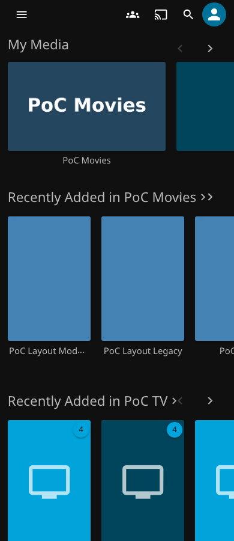
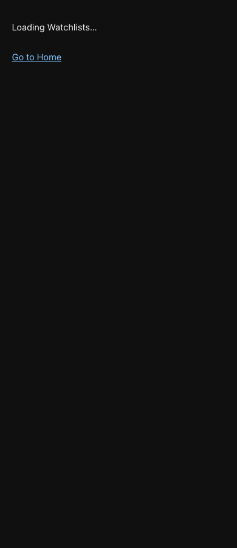

# Watchlists startup qualification — v0.7.4

Based on published v0.7.3 / master `0663d4b`. Full qualification passed on both supported hosts; exact provenance follows. Local focused checks pass: 321 backend tests, 191 JavaScript tests, 21 infrastructure checks and 4 catalog checks.

The published v0.7.3 package (SHA-256 `8082c08a96e4aee46fea8dc22fbde84bdd0c107cb5cc410dd49efaedbc0da20e`) exposed native Home in all 24 initial-render cases: legacy and modern Web, 1280px and 390px, direct entry, reload and cache-disabled hard reload, with either bootstrap or authenticated runtime delayed by 2.2 seconds. The observer is installed with Playwright `addInitScript`, before any entry-document code. It samples visible native Home headings with hit testing on every animation frame, rather than inferring exposure from hidden DOM or final settlement.

The server injects a static anonymous-safe handoff before deferred scripts run. It only starts on `#/home?watchguard=watchlists` (with optional filters), contains no account data and makes no requests. It never changes native nodes, history or authentication. Native DOM/view readiness triggers the existing serialized authenticated loader; its one-second compatibility fallback remains. The runtime mounts navigation immediately instead of waiting for its 500ms maintenance interval. Watchlists owns loading after that handoff.

Temporary UI releases after mounting, navigation away, authentication/script failure or a 20-second deadline. Native Home remains available after failure; reload retries startup. The loading panel also offers a Home link. The server does not relax or rewrite CSP: a policy forbidding inline scripts can block the early handoff, and a policy forbidding blob scripts still blocks the authenticated runtime. A blocked early handoff cannot hide native Web. External Web deployments that bypass the plugin's entry-document middleware do not receive this handoff.

The public catalog, ABI, dependencies, activity query semantics, preference formats and authorization/deletion behavior remain unchanged. Historical qualification is preserved in [v0.7.3 compatibility](compatibility-v073.md) and [v0.7.2 navigation](navigation-validation-v072.md).

Local native startup on Jellyfin Server/Web 12.3.0 passes all 24 initial-render cases (zero Home frames, one panel and one authenticated runtime fetch), four Refresh cases (focus/disclosure/panel/history retained), and fourteen recovery cases. Refresh did not expose Home in the v0.7.3 baseline, but disabling its focused button lost focus; v0.7.4 uses an accessible disabled state and ignores repeated activation during loading.

The first local filter-navigation run recorded one unclassified overlay hit on the modern mobile owner transition, with zero Home exposures or panel replacements. The unchanged assertions passed all 36 operations on the subsequent diagnostic run; element/class/position diagnostics are now retained for any future unexpected hit. Both local outcomes are retained under `docs/evidence/startup-v074/`. Full qualification repeats this suite independently on both supported host versions.

The first full matrices on `ab9332771bcffb15b0c7fa17e5fec47cfb39cceb` were stopped after the 12.3 base-path fixture exposed an obsolete readiness wait: it inspected only `Refresh.disabled`, while the focus-preserving control now reports `aria-disabled`. Its zero-spinner assertion ran before the held activity request completed. The native fixtures now wait for both disabled representations to clear, supporting the archived releases too. No runtime or package change was needed; the corrected fixture commit is qualified in full on both hosts. The superseded runs are not counted as passes.

## Final qualification

Tested runtime/fixture commit: `1a3bc8b2f706d745b38084fcf2c126defe307c11`.

| Jellyfin Server/Web | Full qualification | Result |
| --- | --- | --- |
| 12.3.0 | [40039897794](https://github.com/MajorSchloch/jellyfin-plugin-watchguard/actions/runs/40039897794) | Build + all 11 integration suites passed; publish skipped |
| 12.2.0 | [40039900256](https://github.com/MajorSchloch/jellyfin-plugin-watchguard/actions/runs/40039900256) | Build + all 11 integration suites passed; publish skipped |

Both runs use `publish=false`, `proxy_matrix=true`, official and LinuxServer images pinned by digest, and the same runtime. The [machine-readable provenance](evidence/startup-v074/qualification.json) records exact Server/Web versions, image digests, native signature/filter checks, suite commands, job outcomes and artifact identities.

- ZIP SHA-256: `47c93012c620bc2a85fe75992e26e0614a733218c5bdfc2edf9d7429b716feab`.
- Embedded DLL SHA-256: `c8016c23f6feaa9ab76f3b499a6e8979b88b24c7ee647bc64ac965cd1db58a9a`.
- Both CI packages and the local package are byte-identical.
- 321 backend, 191 JavaScript, 21 infrastructure and 4 catalog checks pass in each build.
- Each host passes 24 pre-bootstrap startup cases, 4 Refresh cases and 14 recovery cases, plus the existing 36 filter-navigation transitions and native history/detail/Home/Favourites travel checks.
- Startup observations show zero Home frames, one panel and one authenticated runtime request per entry. Refresh retains its panel, focus, open disclosure and history state. The real timeout is measured at approximately 20 seconds; it is not simulated by shortening production timers.
- Full native activity coverage includes filtering, ordering, preparation/pagination, initial population, polling, watched/unwatched and playback changes, permission revocation, account isolation and retained-result recovery. Native deletion enforcement, approvals, opt-out, proxy/base-path and personal-store security assertions pass.

The full matrices use Linux/amd64 and Chromium. Local native checks use arm64 and Chromium. This does not qualify every browser engine, custom Web build or CSP configuration. A restrictive policy is honored, and failure/timeout deliberately releases native Web; these are recovery states, not a claim that Watchlists loaded.

## Before/after captures

| Published v0.7.3, runtime request delayed | v0.7.4, same delay |
| --- | --- |
|  |  |

[Desktop baseline](screenshots/v0.7.4/baseline-1280.png), [desktop loading handoff](screenshots/v0.7.4/loading-1280.png), [timeout recovery](screenshots/v0.7.4/timeout-recovery.png). Per-frame observations and all failure outcomes are retained in the linked JSON evidence and CI artifacts. Public catalog and existing release assets remain unchanged.
