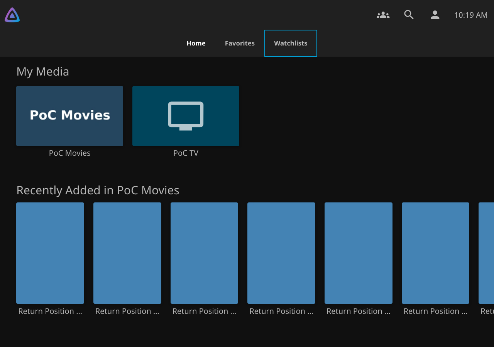
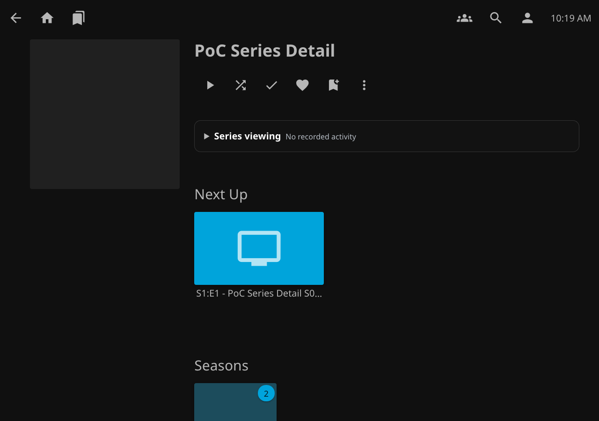
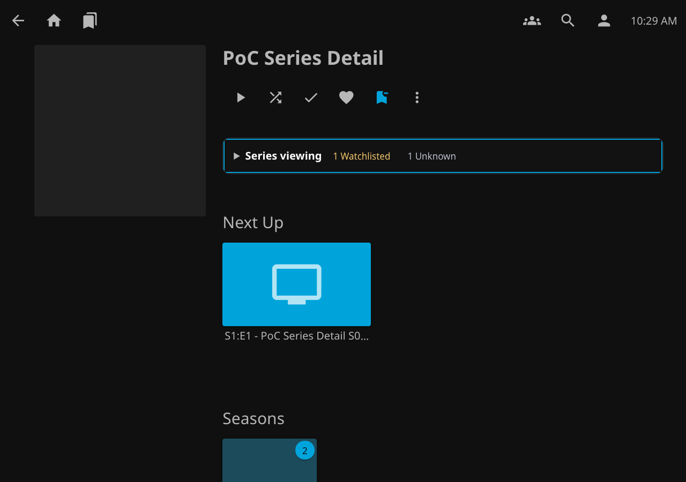

# TV focus correction — v0.7.16 preparation

Published v0.7.15 reproduces both reported focus defects in actual Chromium 79. Native TV tabs highlight text; Watchlists instead shows a border and grey text. The detail summary has a computed outward outline, but its clipped panel renders no focus pixels. Current Chromium renders that detail outline inward through `:focus-visible`.

The patch adds native text focus only to TV top tabs. Other navigation surfaces retain their existing visible outlines. The detail summary uses an inward `:focus` outline in both engines. No event handlers, layout geometry, routing, authorization or stored data change.

The browser regression uses actual arrows in TV layout and Tab in desktop/mobile layouts. It records screenshots, checks rendered focus pixels, opens the disclosure with Enter, closes it with Escape and verifies focus restoration. It also verifies navigation onward. Full current qualification remains required after merge. Physical LG validation remains separate.

Completed browser evidence and the physical-TV procedure are below.

## Observed rendering

The baseline package matches published v0.7.15's ZIP SHA-256 `40b81b2b0ec716b3834085a31d7eab3ed4f9752e3b54a9307333462976897db2`. The [baseline Chromium 79 report](evidence/tv-focus-v0716/baseline-79/focus.json) records a solid CSS outline with a `3px` outward offset, but **zero rendered focus-edge pixels** inside the detail summary. The same engine renders the candidate outline inward at `-3px`. The test compares focused and unfocused screenshot pixels, not just `activeElement` or computed CSS.

TV Home and Favorites use turquoise focus text without an outline. Watchlists now does the same. Its selected state remains white when focus moves elsewhere. This rule is scoped to `.layout-tv .watchguard-nav-tab`; Modern headers, drawers, Desktop Legacy and Mobile Legacy keep their existing outlines. Native tab indexes and arrow handlers are unchanged.

| Chromium 79, published v0.7.15 | Chromium 79, v0.7.16 candidate |
| --- | --- |
|  |  |
|  |  |

[Native Favorites reference](evidence/tv-focus-v0716/baseline-79/tv-favorites-focus.png), [active but unfocused Watchlists](evidence/tv-focus-v0716/candidate-79/tv-watchlists-active.png), [unfocused detail](evidence/tv-focus-v0716/candidate-79/tv-detail-normal.png), and [open detail disclosure](evidence/tv-focus-v0716/candidate-79/tv-detail-open.png) distinguish focus, selection and expansion. Current Chromium [menu](evidence/tv-focus-v0716/candidate-current/tv-watchlists-focus.png) and [detail](evidence/tv-focus-v0716/candidate-current/tv-detail-focus.png) screenshots show the same correction. Desktop/mobile outlines are retained, including [mobile top-menu focus](evidence/tv-focus-v0716/candidate-current/mobile-legacy-watchlists-active-focus.png).

## Validation

The [validation record](evidence/tv-focus-v0716/validation.json) identifies the tested runtime commit, test revisions and exact hashes. The new focus regression runs within the existing current-browser navigation and Chromium 79 jobs. No workflow, permission or qualification-policy change is needed. Existing border assertions outside the TV surface remain unchanged.

- Real Chromium 79.0.3945.0, checksum-pinned snapshot 706915, passed the complete native suite on pinned Jellyfin Server/Web 12.4.0 through `/jellyfin` and the reverse proxy. This includes early filters, return position, remote choices, membership, deletion cancellation, settings and uninstall/data retention. [Report](evidence/tv-focus-v0716/candidate-79/report.json).
- Current Chromium 141.0.7390.37 with Playwright 1.56.1 passed TV arrow and desktop/mobile Tab focus checks, 12 native-control cases, eight navigation-shell cases, ten outgoing handoff cases and 27 return-position cases. Auto, Modern, Desktop Legacy and Mobile Legacy controls were checked at 390, 1280 and 2048px. [Controls](evidence/tv-focus-v0716/controls.json), [navigation](evidence/tv-focus-v0716/navigation-shell.json), [outgoing](evidence/tv-focus-v0716/outgoing.json), [return position](evidence/tv-focus-v0716/return-position.json).
- Existing current-browser control checks also passed for dark, light, purplehaze, blueradiance, appletv and wmc. The new pixel comparisons use the default dark theme; they do not claim TV focus qualification for every theme.
- The complete pinned Jellyfin Server/Web 12.3.0 `/jellyfin --proxy` browser fixture passed in 445.650 seconds, including membership, permission, deletion and uninstall/data-retention checks. [Report](evidence/tv-focus-v0716/core-12.3/report.json).
- Fast checks passed: 306 JavaScript, 376 .NET, 120 Python and eight catalog tests. Deterministic packaging, packaged ES2019 scripts/settings/startup, release notes and policy checks passed.

Candidate ZIP SHA-256: `e473f1bbef8604e9ee8c2e48db40b9d8a183175e6a07b45a4c4976878f8091d2`.

Candidate DLL SHA-256: `155df955cf36014e84f80fa6d3a9a6cb13f7f6420539c04a11b96e1159c8d766`.

[Development notes](evidence/tv-focus-v0716/development.json) record environment failures and test corrections. The final package contains only two scoped focus-CSS changes plus version metadata. Published packages and catalog entries are unchanged.

These local tests use macOS arm64, with the Intel Chromium 79 binary under Rosetta. They are not physical LG tests or a sealed release qualification. After merge, the existing policy must qualify the exact master package before release approval.

## Physical LG check after installation

1. In TV layout, use Left and Right across Home, Favorites and Watchlists. Confirm visible text focus and a distinct selected state.
2. Press OK on Watchlists. Open a series, then use Down to reach its viewing information. Confirm that the whole focus indication is visible.
3. Press OK to open the disclosure. Press Back while focus remains inside it. Confirm that it closes and focus returns to its heading.
4. Open it again and navigate onward. Confirm normal arrow behavior.
5. Return to Watchlists with Back. Confirm restored title focus and position, with no Home flash.
