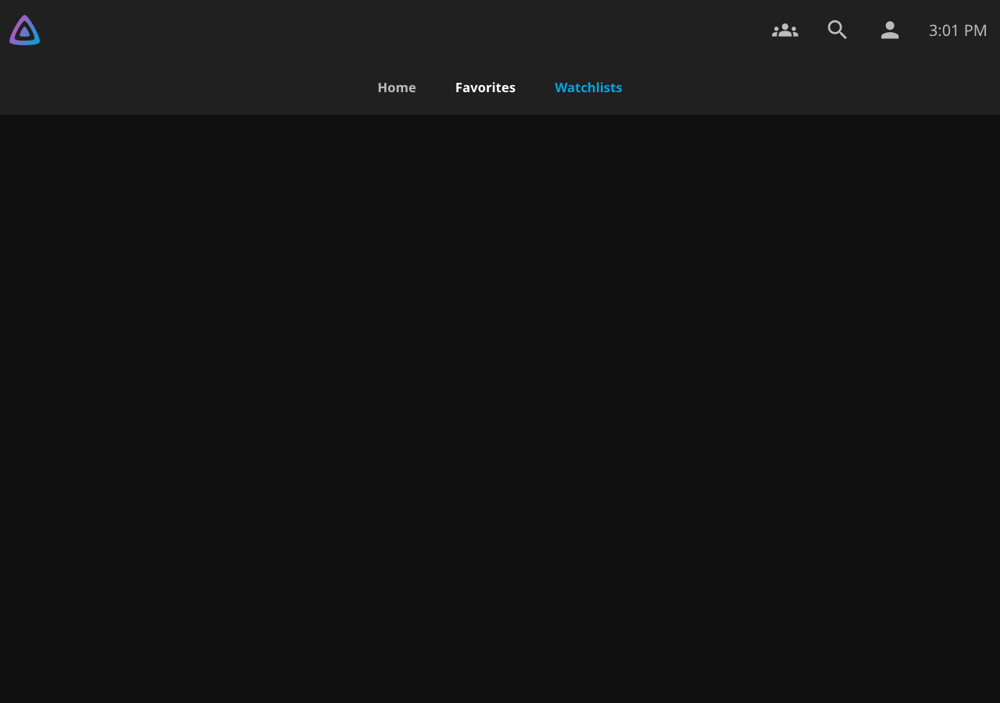
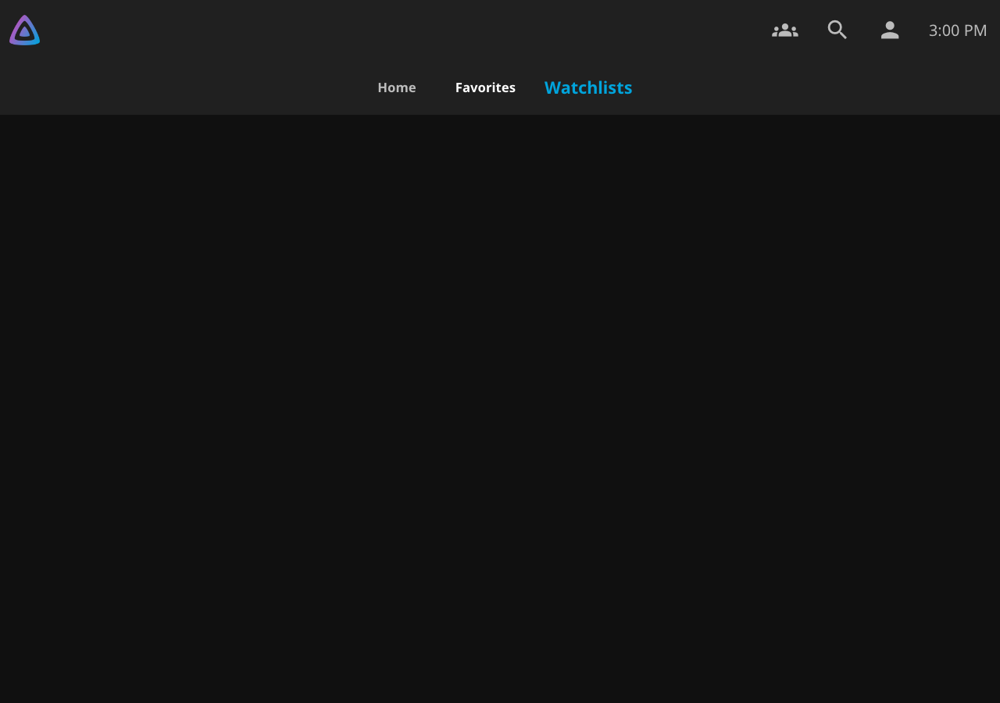
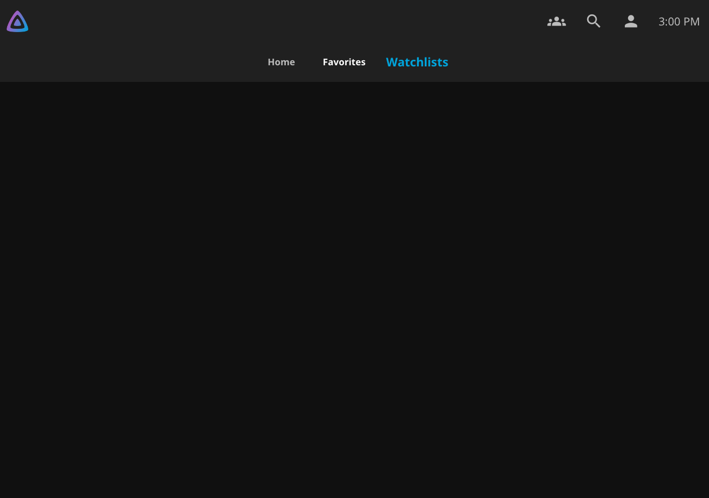

# TV focus polish — v0.7.17 preparation

Published v0.7.16 shows two presentation differences in real Chromium 79 and current Chromium. Native Favorites grows to 1.3 times its resting text size on focus, before or after activation. Selected but unfocused text stays at its resting size. Watchlists retains the text highlight but does not grow. The Series viewing heading has visible straight focus edges, but its rounded panel clips the corners into disconnected lines.

The patch follows the native TV focus scale through a scoped rule. It keeps Watchlists outside Jellyfin’s indexed tab controller; adopting its `emby-tab-button` class would also change which elements that controller manages. The transform does not change layout dimensions. No navigation handlers change.

The detail heading shares its panel’s radius and uses an inset shadow instead of an outline. Chromium 79 renders its curved corners continuously, without depending on `:focus-visible`. Modern pointer-focus suppression remains supported. The rule applies to the focused heading, not `:focus-within`, so focus on an inner control removes the heading indicator.

## Observed states

Each ratio below compares the rendered label against **its own** resting width and height. Favorites and Watchlists have different text widths. Both engines produced these ratios within 0.001. Focusing and activating Watchlists left the neighboring tabs’ layout positions and dimensions unchanged.

| TV label state | Native Favorites | v0.7.16 Watchlists | v0.7.17 Watchlists |
| --- | --- | --- | --- |
| Focus lands through Right arrow | 1.3× | 1× | 1.3× |
| Immediately after OK, with focus retained | 1.3× | 1× | 1.3× |
| Selected, focus elsewhere | 1× | 1× | 1× |
| Selected, focused again | 1.3× | 1× | 1.3× |

The test checks actual text ranges, native activation, rendered focus pixels, corner cutouts and pixel connectivity. The old closed outline has four disconnected components. The corrected heading has one connected ring through all four curved corners and straight edges, closed or open. With focus on the real episode-extras button, the heading has zero focus-edge pixels and only the button shows its focus indicator. Synthetic episode metadata supplies that real control; the test restores the original metadata and user data afterward.

| Actual Chromium 79: published v0.7.16 | Actual Chromium 79: v0.7.17 candidate |
| --- | --- |
|  |  |
|  |  |

The [native Favorites reference](evidence/tv-focus-v0717/candidate-79/tv-favorites-focus.png), [after OK](evidence/tv-focus-v0717/candidate-79/tv-watchlists-after-activation.png), [selected without focus](evidence/tv-focus-v0717/candidate-79/tv-watchlists-active.png), [open heading](evidence/tv-focus-v0717/candidate-79/tv-detail-open.png), and [inner-control focus](evidence/tv-focus-v0717/candidate-79/tv-detail-inner-focus.png) show the separate states.

| Current Chromium: published v0.7.16 | Current Chromium: v0.7.17 candidate |
| --- | --- |
|  |  |
|  |  |

[Mobile keyboard focus](evidence/tv-focus-v0717/candidate-current/mobile-legacy-watchlists-active-focus.png), [mobile heading focus](evidence/tv-focus-v0717/candidate-current/mobile-legacy-detail-focus.png) and [desktop heading focus](evidence/tv-focus-v0717/candidate-current/desktop-legacy-detail-focus.png) remain visible. The focus reports retain measurements and screenshots for TV, Desktop Legacy and Mobile Legacy in [Chromium 79](evidence/tv-focus-v0717/candidate-79/focus.json) and [current Chromium](evidence/tv-focus-v0717/candidate-current/focus.json).

## Initial validation

The [validation record](evidence/tv-focus-v0717/validation.json) identifies exact commits, package hashes and commands. Runtime commit `1ea38dbefa8805c9a9d3e633efb58209c5878a9d` supplied the package. Final focus assertions passed at `fdfe28d3652eda3e76741b806f1268caac57bbe7`; intervening commits change only the screenshot test.

- Real Chromium 79.0.3945.0 passed the complete native suite on pinned Jellyfin Server/Web 12.4.0 through `/jellyfin` and a reverse proxy. This includes remote choices, early filters, return position, membership, deletion cancellation, settings and uninstall/data retention. Total fixture time: 84.500 seconds. [Report](evidence/tv-focus-v0717/candidate-79/report.json).
- Current Chromium 141.0.7390.37 with locked Playwright 1.56.1 passed 12 native-control cases, eight navigation-shell cases, ten outgoing handoff cases and 27 return-position cases. Auto, Modern, Desktop Legacy and Mobile Legacy controls cover 390, 1280 and 2048px. [Controls](evidence/tv-focus-v0717/controls.json), [navigation](evidence/tv-focus-v0717/navigation-shell.json), [outgoing](evidence/tv-focus-v0717/outgoing.json), [return position](evidence/tv-focus-v0717/return-position.json).
- Existing control checks passed for dark, light, purplehaze, blueradiance, appletv and wmc. The new focus pixel comparisons use the default dark theme; they do not qualify every TV theme.
- Pinned Jellyfin Server/Web 12.3.0 core browser checks passed through `/jellyfin` and the proxy in 442.140 seconds, including permissions, deletion protection and uninstall/data retention. [Report](evidence/tv-focus-v0717/core-12.3/report.json).
- Fast checks passed: 306 JavaScript, 376 .NET, 120 Python and eight catalog tests. Repeated packaging produced identical ZIP bytes. All five packaged scripts/settings/startup resources passed ES2019 parsing. Release metadata, notes, qualification policy and catalog validation passed.

ZIP SHA-256: `36091ca7694afeb42174115f316d51097a93ed8de7ecfa542dfb2263a789f580`.

DLL SHA-256: `d54fed17cb63153c4daf6efc759271ea7a3e11898ac3068e48031ac04e8416e5`.

The checksum-verified baseline matches published v0.7.16. Its assets and public catalog entries remain unchanged. [Development notes](evidence/tv-focus-v0717/development.json) record the initial inherited-radius failure and test-oracle corrections.

These local tests ran on macOS arm64, with Intel Chromium 79 under Rosetta. They exercise real browser engines with keyboard/remote-key and viewport/touch emulation, not physical LG hardware. The existing 13-report qualification policy remains required on the exact merged master package before release approval. No workflow or permission changes are included.

## Forced-colors follow-up

The current candidate adds a `forced-colors: active` fallback: `outline: 2px solid Highlight !important` with a `-3px` inset. It overrides the normal `outline:none!important` rule. The existing rounded shadow and TV tab growth remain unchanged outside this media query.

The previous PR package had no rendered focus pixels in forced colors because the browser suppresses shadows. The new current-Chromium check enables forced colors, reaches the heading with Tab, and verifies the visible outline inside the clipped heading. It checks connected corners and straight edges, with no colored pixels in the outer corner cutouts. The system Highlight color can be translucent; the screenshot comparison accounts for its paint over the actual unfocused background.

| Previous PR package | Current candidate |
| --- | --- |
|  |  |

[Full native screenshot](evidence/tv-focus-v0717/forced-colors/detail.png), [unfocused heading](evidence/tv-focus-v0717/forced-colors/unfocused.png), [current-Chromium report](evidence/tv-focus-v0717/forced-colors/current.json), [Chromium 79 report](evidence/tv-focus-v0717/forced-colors/chromium79.json), and [updated package record](evidence/tv-focus-v0717/forced-colors/validation.json).

The new forced-colors check passed with 3,375 visible focus-edge pixels and none when unfocused. All existing normal-theme focus checks passed in current Chromium and actual Chromium 79, including TV growth, rounded corners, inner-control focus and desktop/mobile keyboard focus. The 306 JavaScript tests, eight catalog tests, deterministic packaging, packaged ES2019 scripts, release notes and policy checks passed.

Current ZIP SHA-256: `9b53815b0e7bcbcf99feaa694f36a310235408e5ff27730801f77b695f2e5266`.

Current DLL SHA-256: `75d0dddc6f9ffcd5dd8a8edd1e35ec14c8335f145f8a6617f96d5524e7523be1`.

The initial broader integration evidence above remains tied to its recorded package. This follow-up uses the same pinned Jellyfin 12.4 `/jellyfin` proxy fixture. Forced-colors validation uses Chromium emulation, not a physical high-contrast OS or LG device. Full qualification remains required on the exact merged master package.

## Physical LG check after installation

1. In TV layout, use Left/Right across Home, Favorites and Watchlists. Compare focus text growth and highlight; adjacent tabs should stay still.
2. Press OK on Favorites and Watchlists. Move focus away and back. Confirm that growth follows focus, while the selected state remains distinct.
3. Open a series and use Down to reach Series viewing. Check one continuous rounded indicator, then press OK and check all four corners again.
4. Move to an episode-extras control inside the section. Only that control should show focus. Open and close its details, then close the section with Back and confirm heading focus returns.
5. Navigate onward, then Back to Watchlists. Confirm normal remote behavior, restored position and no Home flash.
